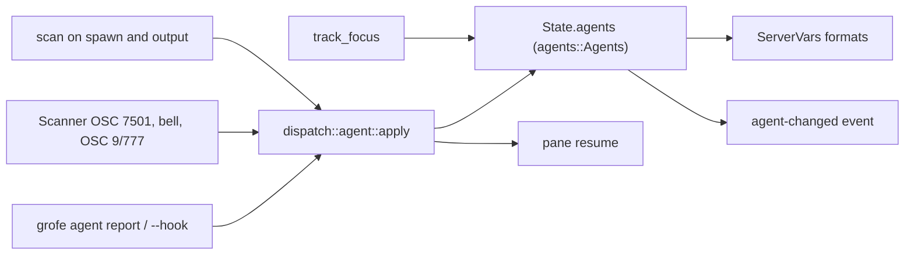
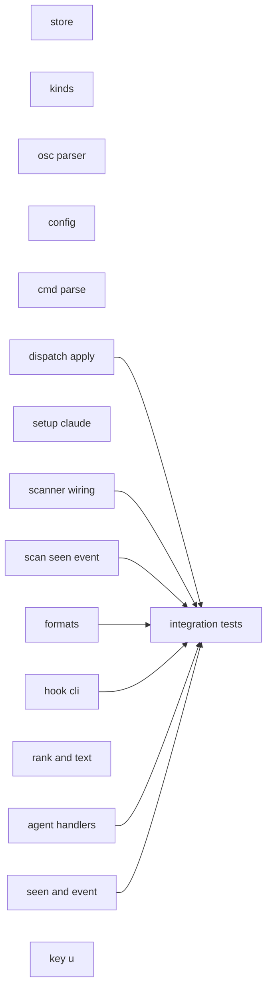

# Agents step 1: core status

**Goal:** spec §12 step 1: agent records, reports (CLI, hook mode, OSC 7501, bell), lifetime, seen, rollups, formats, `agent list|next|seen`, `agent-changed`, resume, `[agents]` config, built-in kinds, `agent setup claude`, key `prefix u`.
**Architecture:** a pure store (`src/server/agents/`) owned by `State.agents`; one server-side entry point `dispatch::agent::apply`; inputs (CLI, scanner, scan, focus) call it.
**Tech stack:** Rust 2024, tokio, serde_json. Tests: `cargo test`.
**Spec:** docs/specs/2026-11-14-agents.md
**Detail:** contracts
**Target-min:** 14

## Global constraints

- CLAUDE.md applies: own files only, no `unwrap()`/`expect()` on socket or pty paths, `cargo fmt`, `cargo clippy --all-targets -- -D warnings`, never real tmux, tests on private `-S` sockets via `tests/common`.
- States: `idle working blocked done error`; canopy names `completed`=done, `exited`=clear. Kind charset `[A-Za-z0-9._-]{1,32}`; session id `[A-Za-z0-9._:-]{1,128}`; msg sanitised then cut to 200 chars (spec §2.7).
- Urgency rank order: Blocked < Error < Unseen < Working < Idle < Done (lower = more urgent).
- Report ordering: drop a report whose `ts` (µs) is older than the record's `last_report`.
- Hook mode exits 0 on everything; connect timeout 30 ms; never waits for a reply; never starts a server.
- grofe identity only for the new default key; `use_tmux_stock` leaves it out.
- Wave 0 (T0) creates every new file with compiling stubs of the Produces signatures and adds the module lines: `pub mod agents;` in `src/server/mod.rs`, `pub mod kinds; pub mod osc;` in `src/server/agents/mod.rs`, `mod agent;` in `src/server/dispatch/mod.rs`, `pub mod agent_cli; pub mod agent_setup;` in `src/lib.rs`, `mod agents;` in `src/config/load.rs`. Owners keep those lines.

## Main diagram

## File structure

- `src/server/agents/mod.rs`: store, report rules, rank, sanitise (T1).
- `src/server/agents/kinds.rs`: built-in kinds, argv matching, resume argv (T2).
- `src/server/agents/osc.rs`: OSC 7501 parser (T3).
- `src/config/load/agents.rs`, `src/config/mod.rs`, `src/config/load.rs`, `src/config/cli.rs`: `[agents]` (T4).
- `src/cmd/mod.rs`, `src/cmd/parse.rs`: `agent` verbs (T5).
- `src/agent_cli.rs`, `src/main.rs`, `src/lib.rs`: hook mode, CLI arms (T6).
- `src/agent_setup.rs`, `Cargo.toml`: `agent setup claude` (T7).
- `src/server/dispatch/agent.rs`, `src/server/dispatch/mod.rs`, `src/server/mod.rs`: handlers, `apply`, state field (T8).
- `src/server/passthrough.rs`, `src/server/pane/mod.rs`: OSC 7501 and bell wiring (T9).
- `src/server/clients.rs`, `src/server/resume.rs`, `src/server/events.rs`, `src/event.rs`, `src/server/hooks.rs`: scan, sweep, seen, event (T10).
- `src/server/dispatch/options.rs`: formats (T11).
- `src/server/input.rs`, `tests/agents.rs`: key `u`, integration tests (T12).

## Task graph

```mermaid
%% schedule
gantt
  title Predicted schedule (mm:ss)
  dateFormat X
  axisFormat %M:%S
  section lane 1
  T6 hook mode and CLI arms :t6, 0, 434s
  T12 integration tests :t12, 513, 366s
  section lane 2
  T7 agent setup claude :t7, 0, 352s
  section lane 3
  T13 rank and text :t13, 0, 332s
  section lane 4
  T15 seen and agent-changed event :t15, 0, 332s
  section lane 5
  T1 agent store :t1, 0, 296s
  T16 default key u :t16, 296, 122s
  section lane 6
  T8 apply and state :t8, 0, 296s
  section lane 7
  T4 [agents] config :t4, 0, 285s
  T9 scanner wiring :t9, 285, 228s
  section lane 8
  T2 kinds and argv matching :t2, 0, 262s
  T10 scan and sweep :t10, 262, 239s
  section lane 9
  T5 agent verbs parse :t5, 0, 262s
  T11 formats :t11, 262, 239s
  section lane 10
  T14 agent command handlers :t14, 0, 262s
  T3 OSC 7501 parser :t3, 262, 228s
```

critical path: T6 → T12 (13.3 min) · peak width 10 · predicted build 14.6 min · predicted total ≈ 18.1 min (target ✗ 14.0)

## Package A: pure core

App type: library. Categories: state, encoding, numeric.
**Probe entry:** call=grofe::server::agents::Agents::apply

### T1 agent store · Complexity 4 · Est. context 30k
**Owns:** src/server/agents/mod.rs
**Components:** 1
**LOC owned:** 170
**Tests:** fast
**Model:** sonnet
**Consumes:** `agents::sanitize(s: &str) -> String` (T13) · `agents::valid_kind(s: &str) -> bool` (T13) · `agents::valid_session_id(s: &str) -> bool` (T13)
**Produces:** `agents::AgentState` (Idle, Working, Blocked, Done, Error; `as_str() -> &'static str`) · `agents::ReportState::parse(s: &str) -> Option<ReportState>` (Set(AgentState) | Clear) · `agents::Report { state: ReportState, kind: Option<String>, msg: Option<String>, blocked: Option<String>, session_id: Option<String>, ts: u64 }` · `agents::Agent { kind: Option<String>, state: AgentState, blocked: Option<String>, msg: Option<String>, since: Instant, unseen: bool, session_id: Option<String>, reported: bool, last_report: u64, binding: Option<resume::Binding> }` · `agents::Agents::apply(&mut self, pane: PaneId, r: Report, seen: bool, now: Instant) -> Option<Change>` · `agents::Change { old: Option<AgentState>, new: Option<AgentState>, session_changed: bool }` · `Agents::ensure(&mut self, pane: PaneId, kind: &str, binding: Option<Binding>, now: Instant) -> bool` · `Agents::mark_seen(&mut self, pane: PaneId) -> bool` · `Agents::attention(&mut self, pane: PaneId, msg: Option<String>) -> bool` · `Agents::remove(&mut self, pane: PaneId) -> Option<Agent>` · `Agents::get(&self, pane: PaneId) -> Option<&Agent>` · `Agents::iter(&self) -> impl Iterator<Item = (PaneId, &Agent)>`
e.g. `ReportState::parse("completed") -> Some(Set(Done))`; `ReportState::parse("exited") -> Some(Clear)`; `ReportState::parse("nope") -> None`
e.g. apply(%1, Set(Done) ts 10, seen=false) on a Working record -> `Some(Change{old:Some(Working), new:Some(Done), session_changed:false})`, `unseen` true
**Review Focus:** state: `late_report_dropped` (record last_report 20, report ts 10 -> None, state unchanged); `same_report_noop` (same state+msg -> None); `working_clears_unseen`; `clear_removes` (Set->Clear -> Change{new:None}); `invalid_kind_ignored` (kind "a b" -> kind stays None); `attention_on_unreported_only`.
**Notes:** mod.rs declares `mod text; mod rank;` and `pub use text::{sanitize, valid_kind, valid_session_id}; pub use rank::{Rank, rank};` (T13's files).
**Steps:** failing tests, implement, pass.

### T13 rank and text · Complexity 3 · Est. context 25k
**Owns:** src/server/agents/rank.rs, src/server/agents/text.rs
**Components:** 2
**LOC owned:** 110
**Tests:** fast
**Model:** sonnet
**Produces:** `agents::Rank` (Blocked, Error, Unseen, Working, Idle, Done; Ord; `as_str`) · `agents::rank(a: &Agent) -> Rank` · `Agents::by_urgency(&self) -> Vec<PaneId>` (inherent impl in rank.rs) · `agents::sanitize(s: &str) -> String` · `agents::valid_kind(s: &str) -> bool` · `agents::valid_session_id(s: &str) -> bool`
e.g. `sanitize("a\x1b[31m#(rm)#[range=user|x]\u{85}b") -> "a[31m_(rm)##[range=user|x]b"`
e.g. `valid_kind("claude") -> true`; `valid_kind("a b") -> false`; `valid_session_id("x;rm") -> false`
**Review Focus:** state: `rank_order` (Blocked, Error, Unseen idle, Working, Idle, Done); `by_urgency_oldest_first_within_rank`; encoding: `sanitize_cuts_200_chars`, `sanitize_strips_c1`, `sanitize_strips_del`.

### T2 kinds and argv matching · Complexity 3 · Est. context 30k
**Owns:** src/server/agents/kinds.rs
**Components:** 1
**LOC owned:** 140
**Tests:** fast
**Model:** sonnet
**Produces:** `kinds::Kind { name: String, matches: Vec<String>, command: Option<String>, resume: Option<String> }` · `kinds::builtin() -> Vec<Kind>` · `kinds::match_argv<'a>(kinds: &'a [Kind], argv: &[String]) -> Option<&'a str>` · `kinds::resume_argv(template: &str, id: &str) -> Option<Vec<String>>`
e.g. `match_argv(&builtin(), &["/usr/local/bin/claude".into(), "--resume".into()]) -> Some("claude")`
e.g. `match_argv(&builtin(), &["uv","run","aider"]) -> Some("aider")`; `&["node","/x/codex.js"] -> Some("codex")`; `&["vim"] -> None`
e.g. `resume_argv("claude --resume {id}", "abc-1") -> Some(["claude","--resume","abc-1"])`; id `"a b"` -> None
**Review Focus:** state: `launcher_skips_options` (`["npx","-y","opencode"]` -> opencode); `pnpm_dlx` (`["pnpm","dlx","gemini"]` -> gemini); `basename_only` (`["/opt/claude-tools/bin/x"]` -> None); encoding: `resume_rejects_bad_id` (`"x;rm"` -> None).
**Notes:** built-in table is spec §8's; `pi` and non-claude resume templates empty (`None`) except `codex resume {id}` and `opencode --session {id}`. Launchers and subcommands: spec §3.1.

### T3 OSC 7501 parser · Complexity 3 · Est. context 25k
**Owns:** src/server/agents/osc.rs
**Components:** 1
**LOC owned:** 110
**Tests:** fast
**Model:** sonnet
**Produces:** `osc::Osc7501` (Query | Report { state: ReportState, blocked: Option<String>, msg: Option<String>, app: Option<String> }) · `osc::parse(body: &[u8]) -> Option<Osc7501>` (body is after `7501;`)
e.g. `parse(b"state=blocked:kind=permission:msg=aGk=") -> Some(Report{state:Set(Blocked), blocked:Some("permission"), msg:Some("hi"), app:None})`
e.g. `parse(b"?") -> Some(Query)`; `parse(b"state=bogus") -> None`; `parse(b"state=clear") -> Some(Report{state:Clear,..})`
**Review Focus:** encoding: `bad_base64_drops_msg` (msg=!!! -> msg None, still Some); `non_root_id_ignored` (`id=build/test:state=done` -> None); `kind_other_than_three_dropped`; numeric: `progress_ignored`.

### T4 [agents] config · Complexity 4 · Est. context 45k
**Owns:** src/config/load/agents.rs, src/config/mod.rs, src/config/load.rs, src/config/cli.rs
**Components:** 1
**LOC owned:** 160
**Tests:** fast
**Model:** sonnet
**Produces:** `config::ConfigAgents { enabled: bool, scan_interval: Duration, kinds: BTreeMap<String, ConfigKind> }` · `config::ConfigKind { matches: Option<Vec<String>>, command: Option<String>, resume: Option<String>, enabled: Option<bool> }` · `Resolved.agents: ConfigAgents` (default enabled, 1 s, empty kinds)
e.g. TOML `[agents.kinds.claude]\nresume = "claude -r {id}"` -> `kinds["claude"].resume == Some("claude -r {id}")`, other fields None
**Review Focus:** protocol: `unknown_key_warns` (`[agents] foo = 1` -> warning with "did you mean"); `kind_name_validated` (`[agents.kinds."a b"]` -> error); `layers_merge_per_key`; `show_config_lists_agents`.
**Notes:** copy `src/config/load/plugins.rs`'s shape; keys `enabled`, `scan-interval`, `kinds.<n>.{match,command,resume,enabled}`.

### T5 agent verbs parse · Complexity 3 · Est. context 40k
**Owns:** src/cmd/mod.rs, src/cmd/parse.rs
**Components:** 1
**LOC owned:** 140
**Tests:** fast
**Model:** sonnet
**Produces:** `Command::Agent(AgentCmd)` · `cmd::AgentCmd` (Report(AgentReport) | List { format: Option<String> } | Next | Seen { target: Target, all: bool }) · `cmd::AgentReport { state: String, target: Target, kind: Option<String>, msg: Option<String>, blocked: Option<String>, session_id: Option<String>, ts: Option<u64> }`
e.g. `parse(["agent","report","done","-t","%3","--msg","ok","--ts","5"]) -> Agent(Report{state:"done", msg:Some("ok"), ts:Some(5), ..})`
**Review Focus:** protocol: `report_needs_state` (Err "agent report: state required"); `blocked_values` (`--blocked foo` Err); `seen_a_and_t_conflict` Err; `unknown_subcommand` Err "agent: unknown subcommand x".

## Package B: CLI

App type: CLI. Categories: protocol, encoding, file.
**Probe entry:** run=grofe agent report

### T6 hook mode and CLI arms · Complexity 5 · Est. context 50k
**Owns:** src/agent_cli.rs, src/main.rs, src/lib.rs
**Components:** 2
**LOC owned:** 200
**Tests:** fast
**Model:** sonnet
**Consumes:** `agent_setup::run(args: &[String]) -> ExitCode` (T7)
**Produces:** `agent_cli::hook_argv(state: &str, kind: &str, payload: &[u8], pane: &str, ts: u64) -> Vec<String>` · `agent_cli::run(globals_socket: &Path, args: &[String]) -> ExitCode`
e.g. `hook_argv("working","claude", br#"{"session_id":"s1","tool_name":"Bash","tool_input":{"command":"ls -la"}}"#, "%4", 7) -> ["agent","report","working","-t","%4","--kind","claude","--ts","7","--session-id","s1","--msg","Bash ls -la"]`
e.g. `hook_argv("done","claude", b"garbage", "%4", 7) -> ["agent","report","done","-t","%4","--kind","claude","--ts","7"]`
**Review Focus:** protocol: `hook_exit_0_no_server`; `hook_exit_0_unknown_flag`; `hook_no_grofe_pane_exit_0`; encoding: `msg_prefers_message_field`; `tool_input_cut_60`; state: `hook_never_waits` (server that never replies: returns within 100 ms).
**Notes:** `main.rs` routes `agent report ... --hook` to `agent_cli::run`, `agent setup` to `agent_setup::run`, other `agent` verbs to `one_shot`. ts = µs since epoch at CLI start. Non-hook `agent report` with no server prints nothing, exits 0.

### T7 agent setup claude · Complexity 5 · Est. context 45k
**Owns:** src/agent_setup.rs, Cargo.toml
**Components:** 1
**LOC owned:** 220
**Tests:** fast
**Model:** sonnet
**Produces:** `agent_setup::run(args: &[String]) -> ExitCode` · `agent_setup::merge_claude(settings: serde_json::Value, grofe: &str) -> serde_json::Value` · `agent_setup::remove_claude(settings: Value, grofe: &str) -> Value`
e.g. `merge_claude(json!({}), "/b/grofe")["hooks"]["Stop"][0]["hooks"][0]["command"] == "/b/grofe agent report done --hook claude"`
**Review Focus:** file: `keeps_key_order`; `symlink_stays_symlink`; `backup_once`; `idempotent`; `remove_exact` (foreign hooks kept); `dry_run_writes_nothing`; `status_lists_kinds`.
**Notes:** add `preserve_order` to serde_json's features. Hook table: spec §8. `$CLAUDE_CONFIG_DIR` else `$HOME/.claude/settings.json`. Prompts on stdin unless `--yes`.

## Package C: server

App type: concurrency. Categories: state, protocol.
**Probe entry:** run=grofe agent list

### T8 apply and state · Complexity 5 · Est. context 35k
**Owns:** src/server/dispatch/agent.rs, src/server/mod.rs
**Components:** 1
**LOC owned:** 170
**Tests:** fast
**Model:** sonnet
**Consumes:** `Agents::apply(&mut self, pane: PaneId, r: Report, seen: bool, now: Instant) -> Option<Change>` (T1) · `kinds::resume_argv(template: &str, id: &str) -> Option<Vec<String>>` (T2) · `events::emit_agent_changed(state: &mut State, pane: PaneId, change: &agents::Change)` (T15) · `Resolved.agents: ConfigAgents` (T4)
**Produces:** `State.agents: agents::Agents`, `State.agent_kinds: Vec<kinds::Kind>`, `State.agents_enabled: bool` · `dispatch::agent::apply(state: &mut State, pane: PaneId, r: Report)` · `dispatch::agent::attention(state: &mut State, pane: PaneId, msg: Option<String>)` · `dispatch::agent::configure(state: &mut State, r: &config::Resolved)` · `dispatch::agent::jump(state: &mut State, ctx: &ClientCtx, pane: PaneId) -> Result<(), String>` · `dispatch::agent::is_seen(state: &State, pane: PaneId) -> bool`
e.g. apply(%1, report done session "s1", kind claude) -> pane %1 resume == Some(["claude","--resume","s1"])
**Review Focus:** state: `report_creates_record`; `report_sets_resume_from_session_id`; `bad_session_id_no_resume`; `disabled_config_ignores_reports`; `apply_emits_change`; `jump_prefers_own_session_for_linked_window`.
**Notes:** `apply` binds a new record via `resume::Binding::of(foreground leader)`; marks all clients dirty on a change; seen per spec §2.4; jump rules spec §5.2. `configure` is called from `apply_config` (options.rs, T11's file): report the one-line call T11 must add, do not edit options.rs.

### T14 agent command handlers · Complexity 4 · Est. context 30k
**Owns:** src/server/dispatch/agent_cmd.rs, src/server/dispatch/mod.rs
**Components:** 1
**LOC owned:** 140
**Tests:** fast
**Model:** sonnet
**Consumes:** `Command::Agent(AgentCmd)` (T5) · `dispatch::agent::apply`, `jump`, `is_seen` (T8) · `Agents::by_urgency(&self) -> Vec<PaneId>` (T13)
**Produces:** `dispatch::agent_cmd::run(state: &mut State, ctx: &ClientCtx, c: AgentCmd) -> Result<String, String>` routed from `dispatch::route`
e.g. `agent list` with %1 blocked, %2 idle -> "%1 claude blocked\n%2 pi idle\n" (default format `#{pane_id} #{agent_kind} #{agent_state}`)
**Review Focus:** state: `list_urgency_order`; `next_jumps_most_urgent_oldest`; `next_none` (Ok, message "no agent needs you"); `seen_all`; `report_default_target_is_ctx_pane`; protocol: `report_unknown_state_err`.
**Notes:** add `mod agent_cmd;` and the `Command::Agent` route arm; `agent list` and `agent seen` read-only flags per `read_only`.

### T9 scanner wiring · Complexity 4 · Est. context 45k
**Owns:** src/server/passthrough.rs, src/server/pane/mod.rs
**Components:** 1
**LOC owned:** 110
**Tests:** fast
**Model:** sonnet
**Consumes:** `osc::parse` (T3) · `dispatch::agent::apply`, `dispatch::agent::attention` (T8)
**Produces:** `PaneEventKind::AgentStatus(Vec<u8>)`
**Review Focus:** protocol: `osc7501_not_relayed`; `wrapped_7501_read`; `query_answered` (writes `\x1b]7501;ok\x1b\\` to the pane); `osc9_progress_ignored` (`9;4;1;50` -> no attention); `bell_on_unreported_agent_sets_unseen`; `bell_on_reported_agent_ignored`.

### T10 scan and sweep · Complexity 4 · Est. context 35k
**Owns:** src/server/clients.rs, src/server/resume.rs
**Components:** 1
**LOC owned:** 120
**Tests:** fast
**Model:** sonnet
**Consumes:** `kinds::match_argv<'a>(kinds: &'a [Kind], argv: &[String]) -> Option<&'a str>` (T2) · `Agents::ensure(&mut self, pane: PaneId, kind: &str, binding: Option<Binding>, now: Instant) -> bool` (T1) · `Agents::remove(&mut self, pane: PaneId) -> Option<Agent>` (T1) · `events::emit_agent_changed(state: &mut State, pane: PaneId, change: &agents::Change)` (T15)
**Produces:** `clients::scan_agents(state: &mut State, panes: &BTreeSet<PaneId>)`
**Review Focus:** state: `scan_throttled_per_pane` (two outputs in 1 s -> one argv read); `scan_on_spawn` (from `resume::spawned`); `dead_binding_swept` (record removed, change new=None emitted); `sweep_timer_runs_while_agents`; `closed_pane_record_removed`.
**Notes:** scan is called from `clients::wake` with the dirty set; `resume::sweep`/`watch` also cover agent bindings (spec §3.1, §2.3).

### T15 seen and agent-changed event · Complexity 4 · Est. context 35k
**Owns:** src/server/events.rs, src/event.rs, src/server/hooks.rs
**Components:** 2
**LOC owned:** 110
**Tests:** fast
**Model:** sonnet
**Consumes:** `Agents::mark_seen(&mut self, pane: PaneId) -> bool` (T1) · `dispatch::agent::is_seen(state: &State, pane: PaneId) -> bool` (T8)
**Produces:** `Event::AgentChanged { pane: PaneId, uid: String, kind: Option<String>, old: Option<String>, new: Option<String> }` · `events::emit_agent_changed(state: &mut State, pane: PaneId, change: &agents::Change)`
e.g. emit for Change{old:None,new:Some(Idle)} on %2 kind claude -> event name "agent-changed", fields pane %2, old null, new "idle"
**Review Focus:** state: `seen_clears_unseen_focused`; `unfocused_client_not_seen`; `focus_unknown_counts_seen`; protocol: `agent_changed_in_names`; `set_hook_agent_changed_accepted`.
**Notes:** seen runs inside `events::track_focus` for every attached client's active pane.

### T11 formats · Complexity 3 · Est. context 45k
**Owns:** src/server/dispatch/options.rs
**Components:** 1
**LOC owned:** 120
**Tests:** fast
**Model:** sonnet
**Consumes:** `Agents::get`, `iter`, `rank` (T1)
**Produces:** format variables of spec §4.1 except `notifications_unread` and `agents_badge` (step 3), in `ServerVars::get`
**Review Focus:** state: `no_record_empty`; `window_rollup_unseen` (idle unseen pane -> "unseen"); `counts`; `agent_since_seconds`.

### T16 default key u · Complexity 1 · Est. context 20k
**Owns:** src/server/input.rs
**Components:** 1
**LOC owned:** 30
**Tests:** fast
**Model:** haiku
**Kind:** mechanical
**Produces:** default binding `prefix u` -> `agent next`, note "Jump to the agent that needs you", grofe identity only
**Review Focus:** protocol: `grofe_binds_u_agent_next` (default tables, grofe identity: prefix `u` cmds == ["agent","next"]); `tmux_identity_has_no_u_binding`.
**Test code (contract):** `grofe_binds_u_agent_next`: build the default prefix table under grofe identity; assert the binding for key `u` has cmds `vec!["agent", "next"]` and desc `"Jump to the agent that needs you"`. `tmux_identity_has_no_u_binding`: build it under tmux identity (`use_tmux_stock`); assert key `u` is unbound.
**Notes:** add the `bind("u", ...)` line in `default_bindings` among the grofe-only defaults.

### T12 integration tests · Complexity 4 · Est. context 35k
**Owns:** tests/agents.rs
**Components:** 1
**LOC owned:** 200
**Tests:** slow
**Model:** sonnet
**Consumes:** `grofe agent report|list|next|seen` CLI (T6, T14), OSC 7501 path (T9), scan (T10), event (T15)
**Produces:** tests only
**Review Focus:** protocol: `report_from_pane_env_listed`; `hook_exit_0_garbage_stdin`; `osc7501_pane_becomes_agent`; `fake_claude_on_path_recognised_and_exit_removes`; `resume_set_from_session_id`; `late_report_dropped`; `agent_changed_subscribed`.

## Self-review

Coverage: spec §12 step 1 items map to T1-T16 (OSC 9/777 relay suppression and notify are step 3). No placeholders. Consumes match Produces names. Edges only to T12 (integration). Disjoint Owns.
