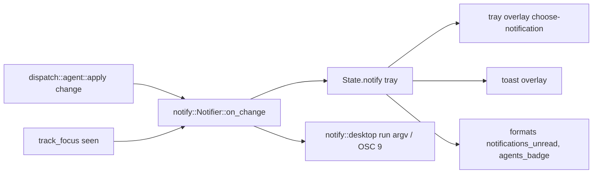
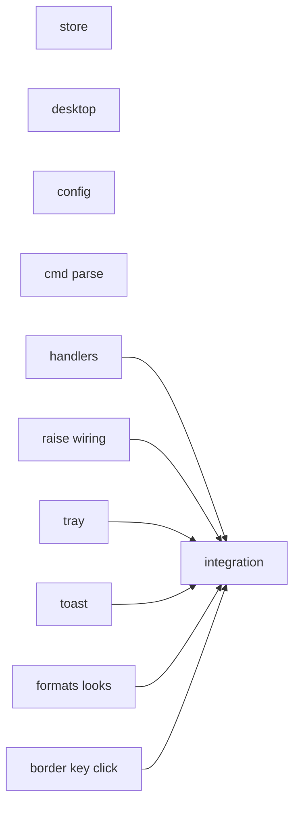

# Agents step 3: notifications and default looks

**Goal:** spec §12 step 3 plus §4.2: notification records and tray (§6.1, §6.2), toasts (§6.3), desktop delivery (§6.4), off switches and mute (§6.5), `[notify]` config (§9), the badge and its click, window glyphs and the blocked border (§4.2), key `prefix y`.
**Architecture:** a pure notification store (`src/server/notify/`) owned by `State.notify`; agent changes and seen events feed it; overlays read it; desktop delivery runs argv commands off the actor.
**Tech stack:** Rust 2024, tokio. Tests: `cargo test`.
**Spec:** docs/specs/2026-11-14-agents.md
**Detail:** contracts
**Target-min:** 14

## Global constraints

- CLAUDE.md applies (own files only, no unwrap on socket/pty paths, never real tmux, private `-S` sockets, `rustfmt --edition 2024` on own files only).
- Notifier commands are argv, never a shell string; agent text is one argv element after `--`; macOS uses `osascript -e 'on run argv' -e 'display notification (item 2 of argv) with title (item 1 of argv)' -e 'end run' -- <title> <message>`; Linux `notify-send -a grofe -- <title> <message>`. 10 s timeout, one in flight, later ones coalesce.
- Only configured kinds raise desktop notifications.
- Defaults (§9): on blocked,error,done; toast blocked; desktop blocked,error,done; history 10; skip-when-seen on; done-min-work 30s; min-interval 10s; toast-time 5s; delivery auto; sound off.
- New default looks and the `y` key are grofe identity only.
- Wave 0 adds `pub(crate) mod notify;`, `pub(crate) mod tray;`, `pub(crate) mod toast;` in src/server/mod.rs and `pub(crate) mod notify;` in src/server/dispatch/mod.rs, plus `pub mod desktop;` in src/server/notify/mod.rs, each new file with one `//!` line, and `pub mod notify;` in src/config/load.rs with that file.

## Main diagram

## File structure

- `src/server/notify/mod.rs`: store, raise rules, read/dismiss/mute (T1).
- `src/server/notify/desktop.rs`: argv building, OSC 9 bytes, runner (T2).
- `src/config/load/notify.rs`, `src/config/mod.rs`, `src/config/load.rs`, `src/config/cli.rs`: `[notify]` (T3).
- `src/cmd/mod.rs`, `src/cmd/parse.rs`: `choose-notification`, `notify ...` (T4).
- `src/server/dispatch/notify.rs`, `src/server/dispatch/mod.rs`, `src/server/mod.rs`: handlers, State field, routes (T5).
- `src/server/dispatch/agent.rs`, `src/server/events.rs`, `src/server/passthrough.rs`: raise on change, read on seen, OSC 9/777 relay suppression (T6).
- `src/server/tray.rs`: tray overlay (T7).
- `src/server/toast.rs`: toast overlay (T8).
- `src/server/dispatch/options.rs`: badge and unread formats, glyph and style options, default status and window formats (T9).
- `src/server/clients.rs`, `src/server/input.rs`: blocked border style, toast deadline, `y` key and badge click (T10).
- `tests/agents_notify.rs`: integration tests (T11).

## Task graph

```mermaid
%% schedule
gantt
  title Predicted schedule (mm:ss)
  dateFormat X
  axisFormat %M:%S
  section lane 1
  T2 desktop delivery :t2, 0, 400s
  section lane 2
  T6 raise and read wiring :t6, 0, 366s
  T11 integration tests :t11, 366, 344s
  section lane 3
  T1 notification store :t1, 0, 352s
  section lane 4
  T10 border  key  click  deadline :t10, 0, 309s
  section lane 5
  T7 tray overlay :t7, 0, 307s
  section lane 6
  T3 [notify] config :t3, 0, 273s
  section lane 7
  T8 toast overlay :t8, 0, 273s
  section lane 8
  T5 handlers and state :t5, 0, 228s
  section lane 9
  T9 formats and default looks :t9, 0, 228s
  section lane 10
  T4 command parsing :t4, 0, 183s
```

critical path: T6 → T11 (11.8 min) · peak width 10 · predicted build 11.8 min · predicted total ≈ 15.3 min (target ✗ 14.0)

## Package A: core

App type: library. Categories: state, encoding.
**Probe entry:** call=grofe::server::notify::Notifier::on_change

### T1 notification store · Complexity 5 · Est. context 35k
**Owns:** src/server/notify/mod.rs
**Components:** 1
**LOC owned:** 220
**Tests:** fast
**Model:** sonnet
**Produces:** `notify::NotifyConfig { enabled: bool, on: Vec<String>, toast: Vec<String>, desktop: Vec<String>, history: usize, skip_when_seen: bool, done_min_work: Duration, min_interval: Duration, toast_time: Duration, delivery: String, sound: bool, command: Option<Vec<String>> }` (Default = spec §9) · `notify::Notification { id: u64, pane: PaneId, uid: String, kind: Option<String>, state: String, msg: Option<String>, at: Instant, read: bool }` · `notify::Raised { id: u64, toast: bool, desktop: bool }` · `notify::Notifier::on_change(&mut self, pane: PaneId, uid: &str, kind: Option<&str>, old: Option<&str>, new: Option<&str>, msg: Option<&str>, worked: Duration, seen: bool, configured_kind: bool, now: Instant) -> Option<Raised>` · `Notifier::seen(&mut self, pane: PaneId) -> bool` · `Notifier::dismiss(&mut self, id: u64) -> bool` · `Notifier::clear(&mut self)` · `Notifier::mute(&mut self, until: Option<Instant>)` · `Notifier::unmute(&mut self)` · `Notifier::muted(&self, now: Instant) -> bool` · `Notifier::unread(&self) -> usize` · `Notifier::items(&self) -> &[Notification]` (newest first) · `Notifier::newest_unread(&self) -> Option<&Notification>` · `Notifier.cfg: NotifyConfig`
e.g. on_change(%1, "u1", Some("claude"), Some("working"), Some("blocked"), Some("perm"), 5s, false, true, t) -> `Some(Raised{id:1, toast:true, desktop:true})`
e.g. same with seen=true -> None; new="done" with worked 3s -> None; a second blocked on %1 within 10 s -> None and item 1's msg replaced
**Review Focus:** state: `history_capped` (11 raises -> 10 items, oldest gone); `read_on_seen`; `read_when_state_left` (blocked item read when new state is working); `muted_raises_tray_only` (toast and desktop false); `disabled_raises_nothing`; `unconfigured_kind_no_desktop`; `dismiss_unknown_false`.

### T2 desktop delivery · Complexity 4 · Est. context 30k
**Owns:** src/server/notify/desktop.rs
**Components:** 2
**LOC owned:** 170
**Tests:** fast
**Model:** sonnet
**Produces:** `desktop::Os` (Mac, Linux) · `desktop::argv(os: Os, title: &str, msg: &str, sound: bool, custom: Option<&[String]>, pane: &str, have_terminal_notifier: bool) -> Vec<String>` · `desktop::osc9(text: &str) -> Vec<u8>` · `desktop::Runner::submit(&mut self, argv: Vec<String>)` (one in flight, latest pending replaces older, 10 s timeout, via tokio::process; no shell)
e.g. `argv(Linux, "grofe", "-rf $(x)", false, None, "%1", false) -> ["notify-send","-a","grofe","--","grofe","-rf $(x)"]`
e.g. `argv(Mac, "t", "m\"q", true, None, "%1", false)[0] == "osascript"`, last two elements `["t", "m\"q"]`, script contains `sound name "default"`
e.g. `osc9("hi") -> b"\x1b]9;hi\x1b\\"`; control chars in text are removed
**Review Focus:** encoding: `custom_placeholders_single_element` (`["n","--","{message}"]` with message "a b" -> `["n","--","a b"]`); `osc9_strips_controls`; state: `runner_coalesces` (3 submits while one runs -> 2 runs total); `runner_timeout_kills`.

### T3 [notify] config · Complexity 3 · Est. context 30k
**Owns:** src/config/load/notify.rs, src/config/mod.rs, src/config/load.rs, src/config/cli.rs
**Components:** 1
**LOC owned:** 150
**Tests:** fast
**Model:** sonnet
**Produces:** `Resolved.notify: notify::NotifyConfig` parsed from `[notify]` (keys of spec §9), provenance under `notify.*`, show-config arm
e.g. TOML `[notify]\ntoast = []` -> `notify.toast == []`, others default
**Review Focus:** protocol: `unknown_key_warns`; `bad_state_name_errors` (`on = ["bogus"]`); `delivery_values` (auto, terminal, command, off only); `command_must_be_array`.
**Notes:** `NotifyConfig` is T1's type (`crate::server::notify::NotifyConfig`); copy `src/config/load/agents.rs`'s shape.

### T4 command parsing · Complexity 2 · Est. context 25k
**Owns:** src/cmd/mod.rs, src/cmd/parse.rs
**Components:** 1
**LOC owned:** 70
**Tests:** fast
**Model:** sonnet
**Produces:** `Command::ChooseNotification` · `Command::Notify(NotifyCmd)` with `cmd::NotifyCmd` (List, Dismiss(u64), Clear, Mute(Option<Duration>), Unmute)
e.g. `parse(["notify","mute","10m"]) -> Notify(Mute(Some(600s)))`; `["notify","dismiss","x"]` -> Err
**Review Focus:** protocol: `notify_unknown_sub`; `mute_bad_duration`.
**Notes:** temporary route arms only if the compiler demands, marked `// T5 replaces this arm`.

## Package B: server

App type: concurrency. Categories: state, protocol.
**Probe entry:** run=grofe notify list

### T5 handlers and state · Complexity 3 · Est. context 30k
**Owns:** src/server/dispatch/notify.rs, src/server/dispatch/mod.rs, src/server/mod.rs
**Components:** 1
**LOC owned:** 110
**Tests:** fast
**Model:** sonnet
**Consumes:** `Notifier` API (T1) · `NotifyCmd` (T4) · `tray::open(state: &mut State, client: ClientId) -> Result<(), String>` (T7)
**Produces:** `State.notify: notify::Notifier`, `State.notify_runner: desktop::Runner` · `dispatch::notify::run(state: &mut State, ctx: &ClientCtx, c: NotifyCmd) -> Result<String, String>` · routes for `Notify` and `ChooseNotification` · `dispatch::notify::configure(state: &mut State, r: &config::Resolved)` (called from `dispatch::agent::configure`, T6)
e.g. `notify list` with one unread blocked item -> "1 %3 claude blocked perm\n"
**Review Focus:** state: `list_newest_first`; `dismiss_then_list_empty`; `mute_then_unmute`.

### T6 raise and read wiring · Complexity 5 · Est. context 40k
**Owns:** src/server/dispatch/agent.rs, src/server/events.rs, src/server/passthrough.rs
**Components:** 2
**LOC owned:** 140
**Tests:** fast
**Model:** sonnet
**Consumes:** `Notifier::on_change`, `Notifier::seen` (T1) · `desktop::argv`, `desktop::osc9`, `Runner::submit` (T2) · `dispatch::notify::configure` (T5)
**Produces:** `dispatch::agent::deliver(state: &mut State, raised: Raised)` (desktop by delivery mode: auto = OSC 9 to clients when some client is known unfocused, command when no client is attached; terminal; command; off)
**Review Focus:** state: `change_raises_and_marks_dirty`; `seen_marks_read`; `auto_unfocused_sends_osc9`; `auto_no_client_runs_command`; `reported_agent_osc9_not_relayed_when_desktop_on`; `worked_time_from_working_since`.
**Notes:** `worked` = time since the record entered `working`, zero if it never did. `configured_kind` = kind is in `state.agent_kinds`.

## Package C: UI

App type: concurrency (overlays). Categories: state, encoding.
**Probe entry:** run=grofe choose-notification

### T7 tray overlay · Complexity 4 · Est. context 35k
**Owns:** src/server/tray.rs
**Components:** 1
**LOC owned:** 180
**Tests:** fast
**Model:** sonnet
**Consumes:** `listview`, `listdraw` (step 2) · `Notifier::items`, `dismiss`, `clear` (T1) · `dispatch::agent::jump` (step 1)
**Produces:** `tray::Trays` (`State.trays`, added by T5 next to `State.notify`) · `tray::open(state: &mut State, client: ClientId) -> Result<(), String>` · `tray::TrayOverlay`, `tray::TrayHook` (registered by T5)
**Review Focus:** state: `enter_jumps_and_marks_read`; `ctrl_x_dismisses`; `ctrl_l_clears`; `click_x_dismisses`; `empty_says_no_notifications`.

### T8 toast overlay · Complexity 4 · Est. context 35k
**Owns:** src/server/toast.rs
**Components:** 1
**LOC owned:** 150
**Tests:** fast
**Model:** sonnet
**Consumes:** `Notifier::newest_unread`, `dismiss` (T1)
**Produces:** `toast::ToastOverlay`, `toast::ToastHook` (mouse: click jumps, click on `x` dismisses; registered by T5) · `toast::deadline(state: &State, client: ClientId) -> Option<Instant>`
**Review Focus:** state: `shown_only_for_toast_states_within_toast_time`; `not_shown_to_client_looking_at_pane`; `newer_replaces`; encoding: `long_msg_cut_by_width`.

### T9 formats and default looks · Complexity 3 · Est. context 35k
**Owns:** src/server/dispatch/options.rs
**Components:** 1
**LOC owned:** 110
**Tests:** fast
**Model:** sonnet
**Produces:** format vars `notifications_unread`, `agents_badge`; options `agent-glyph-blocked` (`⏸`), `agent-glyph-error` (`✗`), `agent-glyph-unseen` (`✓`), `agent-glyph-working` (`●`), `notify-muted-glyph` (`🔕`), `agent-blocked-border-style` (`fg=yellow`); grofe-identity defaults: window status formats show the window's glyph, `status-right` gains `#[range=user|agents]#{agents_badge}#[norange]`
e.g. blocked 2, unseen done 1 -> `agents_badge` == "⏸2 ✓1"; nothing -> ""
**Review Focus:** state: `badge_empty_when_quiet`; `badge_muted_glyph`; `tmux_identity_formats_unchanged`.

### T10 border, key, click, deadline · Complexity 3 · Est. context 35k
**Owns:** src/server/clients.rs, src/server/input.rs
**Components:** 2
**LOC owned:** 90
**Tests:** fast
**Model:** sonnet
**Consumes:** `toast::deadline` (T8) · option `agent-blocked-border-style` (T9)
**Produces:** a blocked agent pane's frame/border uses `agent-blocked-border-style` in `pane_looks`; `clients::deadline` includes `toast::deadline`; grofe defaults `y` -> `choose-notification` (group notifications, "Show notifications") and `MouseDown1Status` opens the tray when `mouse_status_range` is `agents` (else the existing `switch-client -t =`)
**Review Focus:** state: `blocked_pane_border_style`; `toast_deadline_wakes`; `y_binding_grofe_only`; `badge_click_opens_tray`.

### T11 integration tests · Complexity 4 · Est. context 35k
**Owns:** tests/agents_notify.rs
**Components:** 1
**LOC owned:** 180
**Tests:** slow
**Model:** sonnet
**Consumes:** all of the above (real code)
**Produces:** tests only
**Review Focus:** protocol: `blocked_report_lands_in_notify_list`; `seen_pane_raises_nothing`; `notify_command_runs_recording_script_with_argv` (config `delivery = "command"`, `command = ["<script>", "--", "{title}", "{message}"]`, message with `$(` and `"`); `mute_suppresses_command`; `badge_in_status_format`.

## Self-review

Coverage: §4.2, §6.1-§6.5, §9 `[notify]`, key y. No placeholders. Consumes match Produces. Edges only into T11.
