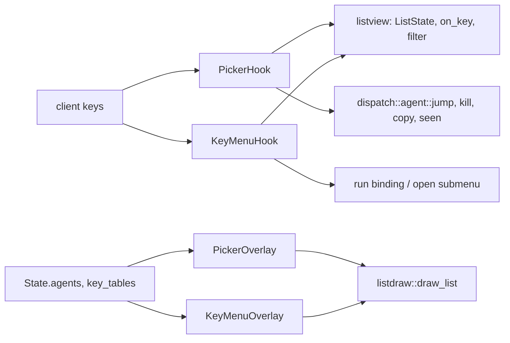
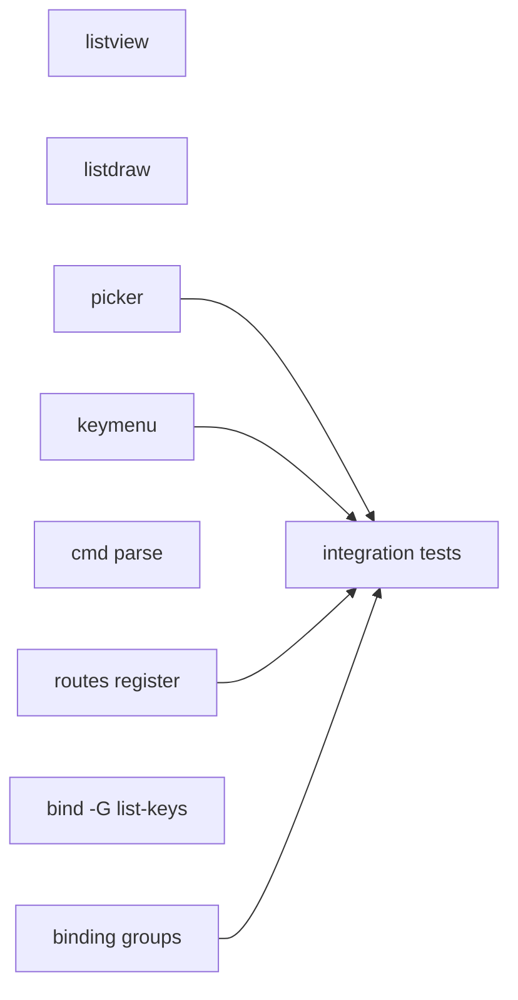

# Agents step 2: list widget, picker, key menu

**Goal:** spec §12 step 2: the list widget (§5.1), the agent picker `choose-agent` (§5.2), the key menu `key-menu` (§5.5) with binding groups, default keys `prefix U`, `prefix Space`, `prefix M-Space`.
**Architecture:** one pure list widget (state, keys, filter, draw) used by two surfaces; each surface is an `Overlay` plus an `InputHook` with per-client state in a field of `State`, registered in `register_builtins`, like `tree.rs`.
**Tech stack:** Rust 2024. Tests: `cargo test`.
**Spec:** docs/specs/2026-11-14-agents.md
**Detail:** contracts
**Target-min:** 14

## Global constraints

- CLAUDE.md applies (own files only, no unwrap on socket/pty paths, never real tmux, private `-S` sockets in tests, `rustfmt --edition 2024` on own files only).
- Surface actions are on ctrl keys only; printable keys type into the query (picker) or run bindings (key menu).
- Key menu reserved keys: `C-n`, `C-p`, `C-f`, `Escape`, `C-c` (they win over the table).
- New default keys are grofe identity only; `use_tmux_stock` drops them. `next-layout` moves from `Space` to `M-Space` under grofe identity only.
- Wave 0 (T0) adds the module lines `mod listview; mod listdraw; mod picker; mod keymenu;` in `src/server/mod.rs` and creates those four files with a `//!` line each. Owners keep the lines.

## Main diagram

## File structure

- `src/server/listview.rs`: fuzzy score, filter, list state and key handling (T1).
- `src/server/listdraw.rs`: drawing a list box with query line and columns (T2).
- `src/server/picker.rs`: agent picker overlay and hook (T3).
- `src/server/keymenu.rs`: key menu overlay and hook (T4).
- `src/cmd/mod.rs`, `src/cmd/parse.rs`: `choose-agent`, `key-menu [-T t]`, `bind-key -G group` (T5).
- `src/server/input.rs`: `Binding.group`, default groups and keys (T6).
- `src/server/dispatch/options.rs`: `bind-key -G`, `list-keys -N` shows group (T7).
- `src/server/dispatch/mod.rs`, `src/server/mod.rs`, `src/server/clients.rs`: routes, registration, picker preview redraw (T8).
- `tests/agents_ui.rs`: integration tests (T9).

## Task graph

```mermaid
%% schedule
gantt
  title Predicted schedule (mm:ss)
  dateFormat X
  axisFormat %M:%S
  section lane 1
  T3 agent picker :t3, 0, 467s
  T9 integration tests :t9, 467, 344s
  section lane 2
  T4 key menu :t4, 0, 467s
  section lane 3
  T1 list state and filter :t1, 0, 285s
  section lane 4
  T2 list drawing :t2, 0, 251s
  section lane 5
  T6 binding groups and default keys :t6, 0, 239s
  section lane 6
  T5 command parsing :t5, 0, 205s
  section lane 7
  T8 routes  registration  redraw :t8, 0, 183s
  section lane 8
  T7 bind -G and list-keys group :t7, 0, 172s
```

critical path: T3 → T9 (13.5 min) · peak width 8 · predicted build 13.5 min · predicted total ≈ 17.0 min (target ✗ 14.0)

## Package A: widget

App type: library. Categories: encoding, state.
**Probe entry:** call=grofe::server::listview::filter

### T1 list state and filter · Complexity 4 · Est. context 30k
**Owns:** src/server/listview.rs
**Components:** 1
**LOC owned:** 160
**Tests:** fast
**Model:** sonnet
**Produces:** `listview::score(query: &str, text: &str) -> Option<i32>` · `listview::filter(texts: &[String], query: &str) -> Vec<usize>` · `listview::ListState { query: String, selected: usize, top: usize, filtering: bool }` (Default) · `listview::ListAction` (None, Moved, QueryChanged, Enter, Close, Ctrl(char)) · `ListState::on_key(&mut self, key: &Key, rows: usize, typing: bool) -> ListAction` · `ListState::clamp(&mut self, rows: usize, height: usize)`
e.g. `score("cl", "claude") -> Some(_)`; `score("xz", "claude") -> None`; `filter(&["claude".into(),"codex".into(),"pi".into()], "c") -> [0, 1]`; `filter(&rows, "") -> [0, 1, 2]`
e.g. on_key(Down) with selected 0, rows 3 -> Moved, selected 1; on_key(Enter) -> Enter; on_key(Escape) -> Close; on_key(C-x) -> Ctrl('x'); on_key('a') with typing=true -> QueryChanged, query "a"; with typing=false -> None
**Review Focus:** state: `selected_clamped_after_filter`; `backspace_on_empty_query_noop`; `pageup_pagedown_by_height`; `ctrl_c_closes`; encoding: `score_case_insensitive`; `score_prefers_contiguous` (score("cl","claude") > score("cl","c_l")); `ties_keep_order`.
**Notes:** `Key` is the client key type in src/server/input.rs. `typing=false` is the key menu before `C-f`; there `C-f` sets `filtering` and returns `QueryChanged`.

### T2 list drawing · Complexity 3 · Est. context 30k
**Owns:** src/server/listdraw.rs
**Components:** 1
**LOC owned:** 130
**Tests:** fast
**Model:** sonnet
**Consumes:** `listview::ListState { query: String, selected: usize, top: usize, filtering: bool }` (T1)
**Produces:** `listdraw::Rows { cols: Vec<Vec<String>> }` · `listdraw::draw_list(screen: &mut Screen, area: Rect, title: &str, rows: &Rows, visible: &[usize], st: &ListState, show_query: bool)` · `listdraw::centred(client: (u16, u16), w_pct: u16, h_pct: u16) -> Rect`
e.g. `centred((100, 50), 80, 70) -> Rect { x: 10, y: 7, w: 80, h: 35 }`
**Review Focus:** encoding: `wide_chars_cut_by_cell_width` (a CJK cell is 2 wide; never split); `columns_aligned` (column widths are the max of visible rows, last column takes the rest); `selected_row_reversed`; `tiny_area_no_panic` (w 3, h 2).
**Notes:** rounded border like popups (`╭─╮`); title in the top edge; query line `> query` at the top inside when `show_query`; no colours beyond reverse for the selection and dim for the hint line.

## Package B: surfaces

App type: concurrency (actor state, input routing). Categories: state, protocol.
**Probe entry:** run=grofe choose-agent

### T3 agent picker · Complexity 5 · Est. context 45k
**Owns:** src/server/picker.rs
**Components:** 2
**LOC owned:** 230
**Tests:** fast
**Consumes:** `listview::ListState::on_key(&mut self, key: &Key, rows: usize, typing: bool) -> ListAction` (T1) · `listview::filter(texts: &[String], query: &str) -> Vec<usize>` (T1) · `listdraw::draw_list(...)` (T2) · `dispatch::agent::jump(state, ctx, pane) -> Result<(), String>` (step 1) · `Agents::by_urgency(&self) -> Vec<PaneId>` (step 1)
**Model:** sonnet
**Produces:** `picker::Pickers` (per-client state, `State.pickers`) · `picker::open(state: &mut State, client: ClientId) -> Result<(), String>` · `picker::PickerOverlay`, `picker::PickerHook` · `picker::selected_pane(state: &State, client: ClientId) -> Option<PaneId>`
e.g. open with agents %1 blocked, %2 idle -> rows in order [%1, %2]; Enter -> client's active pane is %1, picker closed
**Review Focus:** state: `rows_live_after_state_change` (state change while open re-sorts); `ctrl_x_asks_then_kills`; `ctrl_y_copies_target` (OSC 52 of `session:window.pane`); `ctrl_s_marks_seen`; `empty_says_no_agents`; `preview_of_selected`; `closes_when_client_detaches`.
**Notes:** spec §5.2 columns and sort. Size from `agents.picker` is step 2 scope only if the config exists; else 80% by 70%. Preview: the selected pane's visible screen, cropped, below the list in the same box.

### T4 key menu · Complexity 5 · Est. context 45k
**Owns:** src/server/keymenu.rs
**Components:** 2
**LOC owned:** 230
**Tests:** fast
**Consumes:** T1, T2 as above · `Binding.group: Option<String>` (T6)
**Model:** sonnet
**Produces:** `keymenu::Menus` (`State.keymenus`) · `keymenu::open(state: &mut State, client: ClientId, table: &str) -> Result<(), String>` · `keymenu::KeyMenuOverlay`, `keymenu::KeyMenuHook`
e.g. prefix table with `c` (group window, "New window") open; press `c` -> runs `new-window`, menu closed; press `C-f`, type `win`, Enter -> runs the selected row
**Review Focus:** state: `bound_key_runs_and_closes`; `reserved_keys_win` (a binding on C-n still moves); `repeat_binding_leaves_prefix_table`; `switch_client_t_opens_submenu`; `no_group_goes_to_other`; `mouse_and_any_hidden`; protocol: `labels_are_formats` (desc `Agents (#{agents_attention})` expands).
**Notes:** spec §5.5. Rows grouped by group name, groups in first-seen order, `other` last.

## Package C: commands and bindings

App type: CLI. Categories: protocol, state.
**Probe entry:** run=grofe list-keys -N

### T5 command parsing · Complexity 3 · Est. context 30k
**Owns:** src/cmd/mod.rs, src/cmd/parse.rs
**Components:** 1
**LOC owned:** 90
**Tests:** fast
**Model:** sonnet
**Produces:** `Command::ChooseAgent` · `Command::KeyMenu(KeyMenu { table: Option<String> })` · `BindKey.group: Option<String>` (`-G`)
e.g. `parse(["key-menu","-T","prefix"]) -> KeyMenu{table:Some("prefix")}`; `parse(["bind-key","-G","agents","u","agent","next"])` -> group Some("agents")
**Review Focus:** protocol: `choose_agent_no_args`; `key_menu_unknown_flag`; `bind_g_requires_value`.
**Notes:** add temporary route arms `=> Err("not available yet".into())` in src/server/dispatch/mod.rs only if the compiler demands them, marked `// T8 replaces this arm`.

### T6 binding groups and default keys · Complexity 4 · Est. context 40k
**Owns:** src/server/input.rs
**Components:** 1
**LOC owned:** 120
**Tests:** fast
**Model:** sonnet
**Produces:** `Binding.group: Option<String>` · grofe defaults: every default binding has a group (pane, window, session, copy, layout, agents, notifications, client, other); `U` -> `choose-agent` (agents, "Pick an agent"); `Space` -> `key-menu -T prefix` (other, "Show the key menu"); `M-Space` -> `next-layout` (layout); TOML `group` kept by `KeyTables::from_config`
e.g. grofe identity: prefix `Space` cmds == [["key-menu","-T","prefix"]]; tmux identity: prefix `Space` cmds == [["next-layout"]]
**Review Focus:** state: `every_default_has_group`; `toml_group_kept`; `tmux_stock_unchanged`.

### T7 bind -G and list-keys group · Complexity 3 · Est. context 35k
**Owns:** src/server/dispatch/options.rs
**Components:** 1
**LOC owned:** 60
**Tests:** fast
**Model:** sonnet
**Consumes:** `BindKey.group` (T5) · `Binding.group` (T6)
**Produces:** `bind-key -G g` stores the group; `list-keys -N` prints `[group]` after the key when set (grofe dialect only)
**Review Focus:** protocol: `bind_g_stored`; `list_keys_n_shows_group`; `tmux_dialect_list_keys_unchanged`.

### T8 routes, registration, redraw · Complexity 3 · Est. context 35k
**Owns:** src/server/dispatch/mod.rs, src/server/mod.rs, src/server/clients.rs
**Components:** 1
**LOC owned:** 70
**Tests:** fast
**Model:** sonnet
**Consumes:** `picker::open(state: &mut State, client: ClientId) -> Result<(), String>` (T3) · `keymenu::open(state: &mut State, client: ClientId, table: &str) -> Result<(), String>` (T4) · `picker::selected_pane(state: &State, client: ClientId) -> Option<PaneId>` (T3)
**Produces:** routes for `ChooseAgent`, `KeyMenu`; `State.pickers`, `State.keymenus`; hooks and overlays registered in `register_builtins` before the tree hook; `clients::wake` marks a client dirty on output of its picker's selected pane
**Review Focus:** state: `choose_agent_needs_client` (from a CLI with no client: Err "no client"); `wake_redraws_picker_preview`.

## Package D: tests

App type: CLI. Categories: protocol.
**Probe entry:** run=grofe key-menu

### T9 integration tests · Complexity 4 · Est. context 40k
**Owns:** tests/agents_ui.rs
**Components:** 1
**LOC owned:** 180
**Tests:** slow
**Model:** sonnet
**Consumes:** the commands and keys above (real code)
**Produces:** tests only
**Review Focus:** protocol: `prefix_space_opens_key_menu_and_runs_c` (attached pty client: prefix Space then `c` creates a window); `prefix_u_upper_opens_picker_enter_jumps`; `picker_filters_by_typing`; `key_menu_c_f_filter`.
**Notes:** use the pty harness in tests/acceptance (expectrl) and tests/common.

## Self-review

Coverage: §5.1, §5.2, §5.5, §9 keys U/Space/M-Space. Sidebar, grid, tray are later steps. No placeholders. Consumes match Produces.
