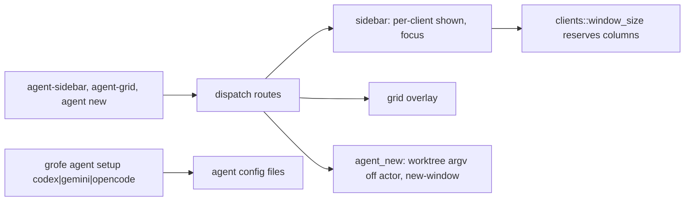
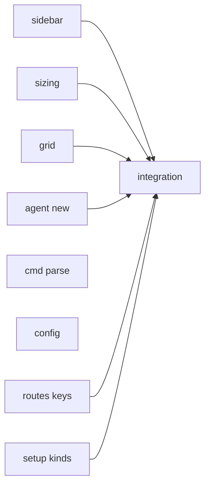

# Agents steps 4 to 6: sidebar, grid, agent new, setup for more kinds

**Goal:** spec §12 steps 4, 5, 6: the sidebar (§5.3), the grid (§5.4), `agent new` with worktrees (§7), `agent setup` for codex, gemini and opencode (§8), their config tables (§9) and keys `b`, `O`.
**Architecture:** sidebar and grid are server-drawn surfaces like the picker; the sidebar also reserves columns in window sizing. `agent new` runs the worktree command off the actor, then opens the window. Setup extends `src/agent_setup.rs` per kind.
**Tech stack:** Rust 2024. Tests: `cargo test`.
**Spec:** docs/specs/2026-11-14-agents.md
**Detail:** contracts
**Target-min:** 14

## Global constraints

- CLAUDE.md applies (own files only, no unwrap on socket/pty paths, never real tmux, private `-S` sockets, `rustfmt --edition 2024` on own files only).
- Sidebar: right side only (`// ponytail:` a left side needs a `window_left` at every `window_top` site); hidden at attach unless `show-on-attach`; per client; hidden while the client is narrower than `min-client-width`; reserves `width + 1` columns from the window only when the size-owning client (D6) shows it.
- Grid: read only; tiles show the bottom `preview-lines` rows of each agent pane.
- `agent new`: worktree command is an argv (never a shell), run off the actor with a 30 s timeout; branch name rules spec §7.
- Setup hook formats (checked 2026-11-14): codex `~/.codex/hooks.json` events SessionStart, UserPromptSubmit, PreToolUse, PostToolUse, Stop, same shape as Claude's; gemini `~/.gemini/settings.json` `hooks` object, events BeforeTool, AfterTool (working), AfterAgent (done), Notification (blocked); opencode a JS plugin file `~/.config/opencode/plugins/grofe.js` subscribing to `session.idle` (done), `permission.asked` (blocked), `tool.execute.before` (working), calling grofe with an argv via Bun's `$`-free spawn. pi ships match and resume only.
- Wave 0 adds `pub(crate) mod sidebar;`, `pub(crate) mod grid;` in src/server/mod.rs and `pub(crate) mod agent_new;` in src/server/dispatch/mod.rs with one-line files.

## Main diagram

## File structure

- `src/server/sidebar.rs`: sidebar state, overlay, hook (T1).
- `src/server/clients.rs`: column reservation in sizing and composition (T2).
- `src/server/grid.rs`: grid overlay and hook (T3).
- `src/server/dispatch/agent_new.rs`: `agent new` (T4).
- `src/cmd/mod.rs`, `src/cmd/parse.rs`: `agent-sidebar`, `agent-grid`, `agent new` parsing (T5).
- `src/config/load/agents.rs`: `[agents.sidebar]`, `[agents.grid]`, `[agents.new]`, `[agents.picker]`, kind `worktree` (T6).
- `src/server/dispatch/mod.rs`, `src/server/mod.rs`, `src/server/input.rs`, `src/server/dispatch/agent_cmd.rs`: routes, state, registration, keys b and O (T7).
- `src/agent_setup.rs`: codex, gemini, opencode (T8).
- `tests/agents_more.rs`: integration tests (T9).

## Task graph

## Package A: surfaces

App type: concurrency (overlays, sizing). Categories: state, numeric.
**Probe entry:** run=grofe agent-sidebar toggle

### T1 sidebar · Complexity 5 · Est. context 40k
**Owns:** src/server/sidebar.rs
**Components:** 2
**LOC owned:** 260
**Tests:** fast
**Model:** sonnet
**Produces:** `sidebar::Sidebars` (`State.sidebars`) · `sidebar::set(state: &mut State, client: ClientId, how: SidebarOp) -> Result<(), String>` with `SidebarOp` (On, Off, Toggle, Focus) · `sidebar::reserved(state: &State, client: ClientId, client_cols: u16) -> u16` (columns taken, 0 when hidden or too narrow) · `sidebar::SidebarOverlay`, `sidebar::SidebarHook`
e.g. width 32, client 160 cols, shown -> `reserved == 33`; client 100 cols (min 120) -> 0; hidden -> 0
**Review Focus:** state: `hidden_at_attach`; `show_on_attach_config`; `click_row_jumps`; `focus_routes_keys_escape_returns`; `rows_grouped_by_session_two_lines`; numeric: `narrow_client_hides`.
**Notes:** config values come from `state.agents_sidebar` (T6 adds `ConfigAgents.sidebar`; T7 copies it into State).

### T2 sidebar sizing · Complexity 6 · Est. context 45k
**Owns:** src/server/clients.rs
**Components:** 1
**LOC owned:** 120
**Tests:** fast
**Model:** sonnet
**Consumes:** `sidebar::reserved(state: &State, client: ClientId, client_cols: u16) -> u16` (T1)
**Produces:** `window_size` takes the size-owning client and subtracts `reserved`; `visible_size` and `compose_client` leave the reserved columns to the overlay; toggling resizes the window (panes get SIGWINCH via the normal resize path)
e.g. client 160x50, status 1 row, sidebar 32 shown -> window 127x49
**Review Focus:** numeric: `window_shrinks_by_reserved`; `other_client_cropped`; `toggle_off_restores`; state: `no_sidebar_sizes_unchanged` (all existing sizing tests stay green).

### T3 grid · Complexity 5 · Est. context 40k
**Owns:** src/server/grid.rs
**Components:** 2
**LOC owned:** 240
**Tests:** fast
**Model:** sonnet
**Produces:** `grid::Grids` (`State.grids`) · `grid::open(state: &mut State, client: ClientId) -> Result<(), String>` · `grid::GridOverlay`, `grid::GridHook` · `grid::visible_panes(state: &State, client: ClientId) -> Vec<PaneId>`
e.g. client 130 cols, tile-width 60 -> 2 columns; 5 agents -> 3 rows, scroll keeps the selected tile visible
**Review Focus:** state: `arrows_move_enter_jumps`; `typing_filters`; `escape_closes`; `empty_says_no_agents`; encoding: `tile_title_cut_by_width`.
**Notes:** reuse listview for the query and filter; tile body is the pane's bottom rows cropped (see picker.rs preview). T7 adds the `clients::wake` redraw for `visible_panes`.

### T4 agent new · Complexity 5 · Est. context 40k
**Owns:** src/server/dispatch/agent_new.rs
**Components:** 2
**LOC owned:** 230
**Tests:** fast
**Model:** sonnet
**Produces:** `agent_new::run(state: &mut State, ctx: &ClientCtx, c: AgentNew) -> Result<String, String>` · `agent_new::worktree_path(repo_root: &Path, branch: &str) -> PathBuf` · `agent_new::valid_branch(b: &str) -> bool` · `agent_new::expand(argv: &[String], dir: &str, branch: &str, path: &str) -> Vec<String>`
e.g. `worktree_path("/r/grofe", "feat/x") -> "/r/worktrees/feat-x"`; `valid_branch("a b") -> false`; `valid_branch("-x") -> false`; `valid_branch("feat/ok") -> true`
**Review Focus:** state: `opens_window_running_kind_command_and_creates_record`; `split_with_p`; `worktree_command_failure_shows_stderr_opens_nothing`; `last_stdout_line_dir_wins`; `ask_prompts_empty_means_none`; protocol: `unknown_kind_err`.
**Notes:** `AgentNew` is T5's. Run the worktree command through tokio::process off the actor and finish in a Job (see prompt::run_shell's pattern); repo root from `git -C <dir> rev-parse --show-toplevel` the same way.

## Package B: commands, config, setup

App type: CLI. Categories: protocol, file.
**Probe entry:** run=grofe agent setup --status

### T5 command parsing · Complexity 2 · Est. context 25k
**Owns:** src/cmd/mod.rs, src/cmd/parse.rs
**Components:** 1
**LOC owned:** 90
**Tests:** fast
**Model:** sonnet
**Produces:** `Command::AgentSidebar(SidebarOp)` (on, off, toggle, focus) · `Command::AgentGrid` · `AgentCmd::New(AgentNew { kind: String, split: bool, cwd: Option<String>, name: Option<String>, worktree: Option<bool>, branch: Option<String>, detached: bool })`
e.g. `parse(["agent","new","claude","-w","-b","feat/x"]) -> Agent(New{kind:"claude", worktree:Some(true), branch:Some("feat/x"), ..})`; `["agent-sidebar","sideways"]` -> Err
**Review Focus:** protocol: `w_and_big_w_conflict`; `sidebar_op_required`.
**Notes:** `SidebarOp` lives in cmd (T1 uses it). Temporary route arms only if demanded, marked `// T7 replaces this arm`.

### T6 config tables · Complexity 3 · Est. context 30k
**Owns:** src/config/load/agents.rs, src/config/mod.rs, src/config/cli.rs
**Components:** 1
**LOC owned:** 140
**Tests:** fast
**Model:** sonnet
**Produces:** `ConfigAgents.sidebar { width: u16, show_on_attach: bool, min_client_width: u16 }` (32, false, 120) · `.grid { tile_width: u16, preview_lines: u16 }` (60, 12) · `.picker { width_pct: u16, height_pct: u16 }` (80, 70) · `.new { worktree: String, worktree_command: Vec<String> }` (never, git default of spec §7) · `ConfigKind.worktree: Option<String>`
**Review Focus:** protocol: `defaults`; `worktree_values` (ask, always, never); `bad_width_errors` (0 or > 200).
**Notes:** the struct definitions live in `src/config/load/agents.rs` already; if `ConfigAgents` is declared in src/config/mod.rs instead, report the exact field lines needed rather than editing mod.rs.

### T7 routes, state, keys · Complexity 4 · Est. context 35k
**Owns:** src/server/dispatch/mod.rs, src/server/mod.rs, src/server/input.rs, src/server/dispatch/agent_cmd.rs
**Components:** 2
**LOC owned:** 110
**Tests:** fast
**Consumes:** T1, T3, T4, T5 Produces · `ConfigAgents` new fields (T6)
**Model:** sonnet
**Produces:** routes `AgentSidebar`, `AgentGrid`, `Agent(New)`; `State.sidebars`, `State.grids`, `State.agents_sidebar`, `State.agents_grid`, `State.agents_new` set from config in `dispatch::agent::configure`'s caller path; picker size from `[agents.picker]`; hooks/overlays registered before the picker's; `clients::wake` redraw for `grid::visible_panes` is T2's file, so report the one line needed; grofe default keys `b` -> `agent-sidebar toggle` (agents, "Toggle the agent sidebar"), `O` -> `agent-grid` (agents, "Show all agents")
**Review Focus:** state: `b_and_o_grofe_only`; `sidebar_needs_client`; `grid_needs_client`.

### T8 setup for codex, gemini, opencode · Complexity 5 · Est. context 40k
**Owns:** src/agent_setup.rs
**Components:** 2
**LOC owned:** 260
**Tests:** fast
**Model:** sonnet
**Produces:** `agent setup codex|gemini|opencode` per the Global constraints formats, same rules as claude (in-place edit, backup once, order kept, idempotent, `--remove` exact, quoted grofe path, `--status` per kind); `pi` prints "pi has no hooks; grofe recognises it by name" and exits 0
e.g. gemini: `settings.json` gains `hooks.AfterAgent[0].hooks[0].command == "'<grofe>' agent report done --hook gemini"`
**Review Focus:** file: `codex_hooks_json_merge`; `gemini_settings_merge_keeps_other_keys`; `opencode_plugin_written_and_removed`; `opencode_plugin_passes_argv_not_shell`; `rerun_idempotent_each_kind`.

### T9 integration tests · Complexity 4 · Est. context 35k
**Owns:** tests/agents_more.rs
**Components:** 1
**LOC owned:** 180
**Tests:** slow
**Model:** sonnet
**Consumes:** all of the above (real code)
**Produces:** tests only
**Review Focus:** protocol: `sidebar_toggle_resizes_window` (attached pty client 160 cols: prefix b then window width 127); `grid_enter_jumps`; `agent_new_opens_window_with_record`; `agent_new_worktree_with_git_repo` (temp git repo, `-w -b feat/x` creates the worktree and the window's cwd is it).

## Self-review

Coverage: §5.3, §5.4, §7, §8 kinds, §9 tables, keys b and O. No placeholders. Edges only into T9.
