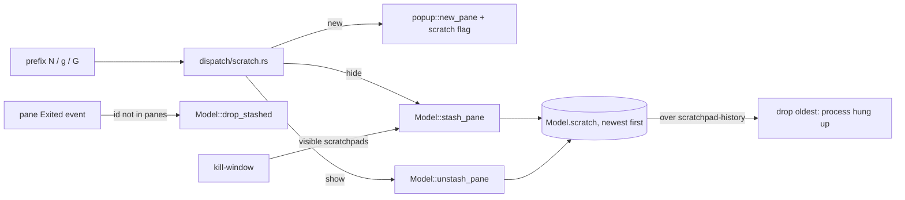
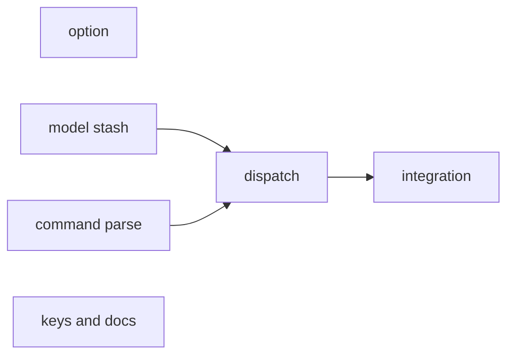

# Scratchpads: design and plan

**Goal:** a key opens a floating scratchpad pane; hiding it keeps it in a
server-wide history (like a clipboard manager) of at most
`scratchpad-history` entries (default 10); a key lists them; unfloating one
makes it an ordinary pane of its window.
**Architecture:** a hidden scratchpad leaves the model's pane and window maps
and lives in `Model.scratch`, so every list, count, render and snapshot path
skips it with no per-site filter.
**Tech stack:** Rust (existing crate), `cargo test`, `bats tests/cli.bats`.
**Spec:** this file, section 1.
**Detail:** tests
**Target-min:** 14

## 1. Design

What the user asked for: a prefix key for a new floating pane; a key listing
scratchpads; a TOML-adjustable history size, default 10; an unfloated
scratchpad becomes part of its window and session, otherwise it lives on as a
scratchpad kept in a history. Answers given: the history is server-wide; the
oldest hidden one is evicted by killing its process; AI orchestrates.

Ruling: hidden panes live outside the window model (`Model.scratch`), not in a
hidden holding session (because a holding session needs excluding from 28
session loops, `closed()`, choose-tree, status and restore, while a pane absent
from `Model.panes` is already invisible everywhere, and pane events for an
unknown id are already dropped in `handle_pane_event`).

Ruling: branch `feat/scratchpads` in the main checkout, no worktree (because
superlite's scripts and agents run in this checkout; main was clean).

### Behaviour

- A **scratchpad** is a floating pane whose `Floating.scratch` is true. A
  visible one is an ordinary floating pane in every other respect.
- `new-scratchpad [-t target-pane] [-c start-directory] [shell-command]` opens
  one in the target's window: 60% of the window's width, 50% of its height,
  centred, active. Ruling: centred and larger than `new-pane`'s default
  (because a scratchpad is a pane you came to work in, not a side view).
- `toggle-scratchpad [-t target-pane]`: a scratchpad target is hidden; else the
  newest hidden scratchpad is shown in the target's window; with none hidden it
  runs `new-scratchpad`. Ruling: the empty case opens one (because a toggle key
  that errors on first use teaches nothing).
- `show-scratchpad [-t target-pane] <pane-id>` shows that hidden scratchpad in
  the target's window, at its last size, held inside the window
  (`floating::placed`), on top, active.
- `list-scratchpads` prints one line per hidden scratchpad, newest first:
  `<n>: <pane-id> <label>`, `n` from 0. The label is the pane's argv joined by
  spaces, else its shell's basename, then ` · ` and its cwd's basename.
- `choose-scratchpad` opens a `display-menu` titled `scratchpads`, newest first,
  item `n` keyed by the digit `n` (digits for the first ten only), each running
  `show-scratchpad <pane-id>`; with none it displays `no scratchpads`.
- Hiding puts the scratchpad at the front of the history. When the history then
  holds more than `scratchpad-history` entries the oldest are dropped, killing
  their processes. `0` means hiding closes it. Visible scratchpads never count.
- Unfloating (`unfloat-pane`, drag and drop, the menu) replaces the `Floating`,
  so the flag is gone: the pane is a normal pane of its window. Floating it
  again makes a plain floating pane.
- A window killed with visible scratchpads hides them instead of killing them.
  Hiding a window's last pane removes the window, as killing it would.
- A hidden scratchpad whose process exits leaves the history.
- Option `scratchpad-history`: grofe's own (`GROFE_ONLY`), global, number
  0..=100, default `10`; TOML key `scratchpad-history`.
- Keys, grofe identity only (dropped with grofe's other prefix defaults under
  tmux identity): `prefix S` `toggle-scratchpad`, `prefix a` `new-scratchpad`,
  `prefix A` `choose-scratchpad`. tmux 3.7b binds none of the three.
  Ruling: S, a and A, not the first-drafted N, g and G (because the user's own
  canopy `user.conf` binds N, g and G, which would shadow grofe's defaults; S,
  a and A are free in tmux 3.7b, canopy's key table and that file).

`// ponytail:` ceilings to mark: hidden scratchpads are not saved by snapshots
or restored; `pane-exited` is not emitted for an evicted scratchpad.

### Data flow

## 2. File structure

- `src/server/dispatch/options.rs`: the option row. `src/config/mod.rs`: TOML key, Int type.
- `src/server/model.rs`: `Floating.scratch`, `Stashed`, `Model.scratch`, stash/unstash/drop.
- `src/server/links.rs`: window kill hides visible scratchpads.
- `src/server/mod.rs`: exit of a hidden pane.
- `src/server/drop.rs`, `src/server/floating.rs`, `src/server/dispatch/popup.rs`: `scratch: false` in `Floating` literals.
- `src/cmd/mod.rs`, `src/cmd/parse.rs`: the five commands.
- `src/server/dispatch/scratch.rs` (new), `src/server/dispatch/mod.rs`: their handlers.
- `src/server/input.rs`: the keys. `README.md`: the docs. `tests/scratchpads.rs` (new): integration.

## 3. Global constraints

- CLAUDE.md applies: `cargo fmt`, `cargo clippy --all-targets -- -D warnings`,
  `cargo test`, no `unwrap()`/`expect()` on socket or pty paths, no em dash as
  a sentence break, never `tmux` on the default server.
- Integration tests use `tests/common` with a unique `-S` socket.
- Test command: `cargo test <filter>`; the whole suite is slow.
- Command names, flags and the option name above are binding.

## 4. Task graph

```mermaid
%% schedule
gantt
  title Predicted schedule (mm:ss)
  dateFormat X
  axisFormat %M:%S
  section lane 1
  T2 model stash :t2, 0, 467s
  T4 scratchpad handlers :t4, 467, 285s
  T6 scratchpad integration tests :t6, 752, 276s
  section lane 2
  T3 parse the five commands :t3, 0, 188s
  section lane 3
  T5 keys and README :t5, 0, 140s
  section lane 4
  T1 scratchpad-history option :t1, 0, 128s
```

critical path: T2 → T4 → T6 (17.1 min) · peak width 4 · predicted build 17.1 min · predicted total ≈ 20.6 min (target ✗ 14.0)

## 5. Option

**Probe entry:** run=grofe show-options -g scratchpad-history

### T1 scratchpad-history option · Complexity 2 · Est. context 30k
**Owns:** src/server/dispatch/options.rs, src/config/mod.rs
**Components:** 1
**LOC owned:** 40
**Tests:** fast
**Kind:** mechanical
**Model:** haiku
**Est. time:** 1.5 min
**Consumes:** none
**Produces:** option `scratchpad-history` (global, Number 0..=100, default "10", GROFE_ONLY)
**Review Focus:** `scratchpad_history_default_is_ten`: `Options::new(false)` looks up `scratchpad-history` as "10"; `scratchpad_history_toml_is_int`: TOML `scratchpad-history = 3` loads, `scratchpad-history = "x"` is an error naming the key
**Test code:** unit tests beside the existing `pane-gap` tests in each file, named as in Review Focus.
**Steps:** copy `buffer-limit`'s `Builtin` row shape (Global, Number) with `max: 100`, default `"10"`; add to `GROFE_ONLY`; add `("scratchpad-history", "scratchpad-history")` to `OPTION_NAMES` and to the `Ty::Int` arm.

## 6. Model

**Probe entry:** call=grofe::server::model::Model::stash_pane

### T2 model stash · Complexity 6 · Est. context 60k
**Owns:** src/server/model.rs, src/server/links.rs, src/server/mod.rs, src/server/drop.rs, src/server/floating.rs, src/server/dispatch/popup.rs
**Components:** 2
**LOC owned:** 230
**Tests:** fast
**Model:** sonnet
**Est. time:** 4 min
**Consumes:** option `scratchpad-history` (T1), read with `options.lookup("scratchpad-history", &[])`, missing means 10
**Produces:** `Floating.scratch: bool` · `pub struct Stashed { pub pane: Pane, pub place: Floating }` · `Model.scratch: Vec<Stashed>` (newest first) · `Model::stash_pane(&mut self, pane: PaneId) -> Result<Removed, String>` · `Model::unstash_pane(&mut self, pane: PaneId, window: WindowId) -> Result<(), String>` · `Model::drop_stashed(&mut self, pane: PaneId, generation: u64) -> bool`
e.g. stash_pane(%3) where %3 is a scratchpad in @1 with %1 tiled -> Ok(vec![]); scratch[0].pane.id == %3; windows[@1].pane_ids() == [%1]
e.g. stash_pane(%1) where %1 is tiled -> Err("pane is not a scratchpad")
e.g. unstash_pane(%3, @2) -> Ok(()); panes[%3].window == @2; windows[@2].active == %3; scratch empty
**Review Focus:** state: `stash_evicts_oldest_over_limit` (limit 2, stash %3 %4 %5 -> scratch ids [%5, %4], %3 gone from the model, returned in Removed); `stash_limit_zero_closes` (limit 0 -> scratch empty); `stash_last_pane_removes_window` (window of only a scratchpad after its tiled pane left: window gone, session cascade as `remove_window`); `unstash_clamps_into_smaller_window` (place 60x20 at (30,10) into a 40x12 window -> `floating::placed` result, size kept); `unstash_unknown_is_error` -> Err("no such scratchpad: %9"); `kill_window_hides_visible_scratchpads` (kill-window on @1 holding scratchpad %3 -> %3 in scratch, not in Removed); `drop_stashed_on_exit` (Exited for a hidden id with matching generation -> removed, wrong generation -> kept)
**Test code:** unit tests in `model.rs`'s test module, named as in Review Focus, built with its existing window and pane fixtures.
**Steps:** add `scratch: bool` (false at every existing `Floating {` literal); stash: must be floating with `scratch`, take its `Floating` as `place`, remove from window as `remove_pane` does for a floating pane (or remove the window if it was the last pane, without taking the pane), take it out of `panes`, insert at front, then pop from the back past the limit and return those as `take_panes` would; unstash: re-parent, top z, `set_active`, resize the pty to `place`'s size; in `links::kill_window_everywhere`, before the window's panes are taken, stash each visible scratchpad of a window that is really going (not just unlinked); in `handle_pane_event`, when `panes` has no such id call `drop_stashed` on `Exited`.
**Notes:** `pane-exited` for evicted panes is a `// ponytail:` ceiling (section 1).

## 7. Commands

**Probe entry:** run=grofe new-scratchpad

### T3 parse the five commands · Complexity 3 · Est. context 45k
**Owns:** src/cmd/mod.rs, src/cmd/parse.rs, src/server/dispatch/mod.rs
**Components:** 1
**LOC owned:** 140
**Tests:** fast
**Kind:** mechanical
**Model:** haiku
**Est. time:** 2 min
**Consumes:** none
**Produces:** `Command::NewScratchpad(NewScratchpad { target: Target, cwd: Option<String>, command: Option<Vec<String>> })` · `Command::ToggleScratchpad(ToggleScratchpad { target: Target })` · `Command::ShowScratchpad(ShowScratchpad { target: Target, pane: PaneId })` · `Command::ListScratchpads` · `Command::ChooseScratchpad`
e.g. parse(["show-scratchpad", "%4"]) -> ShowScratchpad { target: Target::default(), pane: PaneId(4) }
e.g. parse(["new-scratchpad", "-c", "/tmp", "htop"]) -> NewScratchpad { cwd: Some("/tmp"), command: Some(["htop"]), .. }
**Review Focus:** protocol: `show_scratchpad_needs_a_pane_id` (no positional and `show-scratchpad 4` both Err); `list_scratchpads_takes_no_args` (`list-scratchpads x` Err); `toggle_scratchpad_unknown_flag` (`-x` -> "command toggle-scratchpad: unknown flag -x")
**Test code:** in `parse.rs`'s tests beside `unfloat`, named as in Review Focus plus one success test per command.
**Steps:** follow `UnfloatPane` exactly: struct with doc comment in `cmd/mod.rs`, `Command` variant, `parse_*` fn, the name match arm. `new-scratchpad` copies `new-pane`'s `-t -c` and trailing shell-command handling. Add one arm per variant in `dispatch/mod.rs` returning `Err("<name>: not implemented".to_string())`, and an arm in any other exhaustive `Command` match the build names; T4 replaces the dispatch arms.

### T4 scratchpad handlers · Complexity 5 · Est. context 45k
**Owns:** src/server/dispatch/scratch.rs, src/server/dispatch/mod.rs
**Components:** 1
**LOC owned:** 160
**Tests:** fast
**Model:** sonnet
**Est. time:** 3 min
**Consumes:** `Model::stash_pane` · `Model::unstash_pane` · `Model.scratch` · `Floating.scratch` (T2) · the five `Command` variants (T3) · `popup::new_pane(state, ctx, NewPane) -> Result<String, String>` (exists) · `menu::display_menu` (exists)
**Produces:** `scratch::new(state: &mut State, ctx: &ClientCtx, c: NewScratchpad) -> Result<String, String>`, and `toggle`, `show`, `list`, `choose` likewise, wired into `dispatch/mod.rs`
e.g. list with %5 then %3 hidden -> "0: %5 htop · tmp\n1: %3 zsh · grofe\n"
**Review Focus:** state: `new_is_centred_scratch` (80x24 window -> cols 48, rows 12, x 16, y 6, `scratch` true); `toggle_hides_then_shows`; `toggle_with_none_opens_one`; `show_unknown_pane_errors` -> Err("no such scratchpad: %99"); `choose_with_none_says_so`
**Test code:** unit tests in `scratch.rs` driving commands through the dispatcher as `popup.rs`'s tests do (`run(&mut state, &[...])`), named as in Review Focus.
**Steps:** `new` builds a `NewPane` with width 60%, height 50% and x, y centring it, calls `popup::new_pane`, then sets `scratch = true` on the new `Floating`; the `Removed` from `stash_pane` is emitted as `kill-pane` emits its removed panes; `choose` builds `display-menu -T scratchpads` argv items `"<label>" <n> "show-scratchpad <id>"` and runs it through `menu::display_menu`.

### T6 scratchpad integration tests · Complexity 3 · Est. context 35k
**Owns:** tests/scratchpads.rs
**Components:** 1
**LOC owned:** 120
**Tests:** slow
**Model:** sonnet
**Est. time:** 2.5 min
**Consumes:** the five commands through the CLI (T4)
**Produces:** none
**Review Focus:** protocol and state on a `-S` socket: `toggle_round_trip` (new, toggle hides: `list-panes` loses it, `list-scratchpads` shows `0: %N`; toggle shows it again, active); `show_into_another_session` (hide in session a, `show-scratchpad -t b: %N` -> pane listed in b); `history_limit_from_option` (`set -g scratchpad-history 2`, hide 3 -> 2 lines, oldest gone); `unfloat_makes_it_normal` (unfloat then toggle -> a new scratchpad opens, the old pane stays tiled); `kill_window_keeps_scratchpad` (kill-window holding a visible scratchpad -> `list-scratchpads` lists it)
**Test code:** `tests/scratchpads.rs` using `tests/common`, named as in Review Focus.
**Steps:** write the tests and run them; report any failure with its output rather than editing other files.

## 8. Keys and docs

**Probe entry:** run=grofe list-keys -T prefix N

### T5 keys and README · Complexity 2 · Est. context 35k
**Owns:** src/server/input.rs, README.md
**Components:** 1
**LOC owned:** 60
**Tests:** fast
**Kind:** mechanical
**Model:** haiku
**Est. time:** 1.5 min
**Consumes:** command names `new-scratchpad`, `toggle-scratchpad`, `choose-scratchpad` (T3, names only)
**Produces:** prefix bindings `N`, `g`, `G` under grofe identity
**Review Focus:** `grofe_binds_scratchpad_keys` (prefix N, g, G exist with notes "Open a scratchpad", "Hide or show a scratchpad", "Choose a scratchpad from a list"); `tmux_identity_drops_scratchpad_keys` (after `use_tmux_stock`, none of the three bound)
**Test code:** in `input.rs` beside the FR.4 `f`/`F` test, named as in Review Focus.
**Steps:** three `bind(...)` rows next to the `f`/`F` loop, grofe's own like `Q`; README: a short "Scratchpads" section next to floating panes with the three keys, the commands and the option.

## 9. Review Focus

- Option (CLI config): protocol (value range), file (TOML).
- Model (state): eviction order, window cascade on hiding the last pane,
  re-parenting across sessions, generation check on exit.
- Commands (CLI): protocol (flags, positionals), state (round trips).
- Keys: identity split.

## 10. Self-review

Coverage: every behaviour bullet maps to T1 to T5. No placeholders. Consumes
match Produces by name. T2 and T3 run with T1 and T5; T4 waits for T2 and T3,
whose code its tests run; T6 waits for T4. T3 and T4 share `dispatch/mod.rs`
in sequence only. No two parallel tasks share a file.
