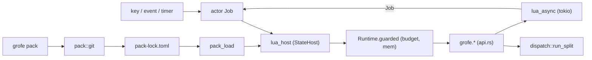
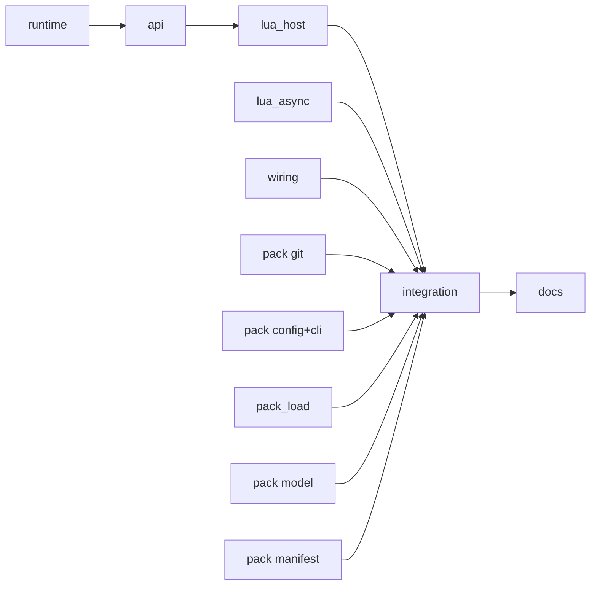

# Luau scripting and a plugin manager

**Goal:** an in-process Luau runtime (`init.luau`, a small `grofe.*` API) that can never freeze the server, and `grofe pack`, a git plus lockfile plugin manager for Luau and tmux plugins.
**Architecture:** Luau runs on the server actor inside every callback's time budget; async work runs off the actor and posts its callback back as a `Job`. `grofe pack` is client-side and never runs inside the server.
**Tech stack:** Rust 2024, mlua 0.12 (`luau`, `send`), tokio, toml, git CLI.
**Spec:** docs/specs/2026-11-14-lua-plugins.md; amends spec §5.1 and §7 (owner ruling 2026-11-14 reverses the 2026-09-29 Lua drop).
**Detail:** tests (T1 full)
**Target-min:** 14

## Design

In docs/specs/2026-11-14-lua-plugins.md (rulings, no-freeze contract, API v1, loading, grofe pack).

Ruling: sequential [chain-16a3] - T2 runs Luau through T1's budgeted runtime and T3 through T2's scoped host, so each needs the previous one's real behaviour to test - cost if wrong: about 10 min of wall time.

## Main diagram



## File structure

`src/lua/` VM and API; `src/server/{lua_host,lua_async,pack_load}.rs`; `src/pack/` manager; per-task Owns below.

## Task graph

```mermaid
%% schedule
gantt
  title Predicted schedule (mm:ss)
  dateFormat X
  axisFormat %M:%S
  section lane 1
  T8 pack config and CLI :t8, 0, 377s
  T3 lua_host :t3, 614, 330s
  T10 integration :t10, 944, 470s
  T11 docs :t11, 1414, 366s
  section lane 2
  T7 pack git :t7, 0, 366s
  section lane 3
  T6 pack spec and lock :t6, 0, 332s
  section lane 4
  T5 wiring :t5, 0, 309s
  section lane 5
  T4 lua_async :t4, 0, 285s
  section lane 6
  T1 runtime :t1, 0, 262s
  T2 api :t2, 262, 352s
  section lane 7
  T9 pack_load :t9, 0, 194s
  section lane 8
  T12 pack manifest :t12, 0, 172s
```





critical path: T1 → T2 → T3 → T10 → T11 (29.7 min) · peak width 8 · predicted build 29.7 min · predicted total ≈ 33.2 min (target ✗ 14.0)

## Global constraints

- Run every test with grofe isolated: `T=$(mktemp -d /tmp/gci.XXXX); env -u GROFE -u GROFE_PANE -u TMUX -u TMUX_PANE TMPDIR=$T XDG_RUNTIME_DIR=$T cargo test ...`. Never run `tmux` or grofe without a private socket.
- `cargo fmt`, `cargo clippy --all-targets -- -D warnings`. No `unwrap`/`expect` on socket, pty or Lua entry paths outside tests.
- No em dash as a sentence break. Conventional commits. No AI attribution.
- `pub const PLUGIN_API: u32 = 1` lives in `src/pack/mod.rs` (T0). Bindings made by Lua use `BindingSource::Plugin("lua".into())`. Callback ids are `u32` from 1.
- Wave 0 (T0): `.superlite/briefs/wave0-stubs.md`.

## Lua runtime

### T1 runtime · Complexity 6 · Est. context 30k
**Owns:** src/lua/runtime.rs
**Components:** 1
**LOC owned:** 140
**Tests:** fast
**Model:** sonnet
**Kind:** design
**Detail:** full
**Produces:** `lua::runtime::Runtime::new(limits: Limits) -> Result<Runtime, LuaError>` · `lua::runtime::Runtime::guarded<R>(&self, who: &str, f: impl FnOnce(&mlua::Lua) -> mlua::Result<R>) -> Result<R, LuaError>` · `lua::runtime::Runtime::exec(&self, who: &str, src: &str) -> Result<(), LuaError>` · `lua::runtime::Runtime::lua(&self) -> &mlua::Lua` · `Limits { budget: Duration, memory: usize }` with `Default` 50 ms, 64 MiB · `LuaError { who: String, message: String }`, Display `"{who}: {message}"`
e.g. `Runtime::new(Limits::default())?.exec("init.luau", "x = 1")` -> `Ok(())`
e.g. `rt.exec("t", "while true do end")` -> `Err(LuaError { who: "t", message: "over its 50 ms budget" })`
e.g. `rt.exec("t", "assert(io == nil and os.execute == nil)")` -> `Ok(())`
**Review Focus:** state: a pcall loop still ends; the next call after an abort runs normally.
**Test code (verbatim):**
```rust
#[cfg(test)]
mod tests {
    use super::*;
    use std::time::{Duration, Instant};
    fn rt() -> Runtime { Runtime::new(Limits::default()).unwrap() }
    #[test] fn a_spin_ends_within_twice_the_budget() {
        let r = rt(); let t = Instant::now();
        let e = r.exec("spin", "while true do end").unwrap_err();
        assert!(t.elapsed() < Duration::from_millis(100), "{:?}", t.elapsed());
        assert_eq!(e.who, "spin"); assert!(e.message.contains("budget"), "{e}");
    }
    #[test] fn pcall_cannot_swallow_the_budget() {
        let r = rt(); let t = Instant::now();
        assert!(r.exec("p", "while true do pcall(function() while true do end end) end").is_err());
        assert!(t.elapsed() < Duration::from_millis(100));
    }
    #[test] fn the_next_call_after_an_abort_runs() {
        let r = rt(); let _ = r.exec("a", "while true do end");
        r.exec("b", "y = 2").unwrap();
        assert_eq!(r.lua().globals().get::<i64>("y").unwrap(), 2);
    }
    #[test] fn no_blocking_stdlib() { rt().exec("s", "assert(io == nil and os.execute == nil and loadstring == nil)").unwrap(); }
    #[test] fn memory_is_capped() {
        let r = Runtime::new(Limits { memory: 8 << 20, ..Limits::default() }).unwrap();
        let e = r.exec("m", "local t = {} for i = 1, 1e8 do t[i] = string.rep('x', 64) end").unwrap_err();
        assert!(e.message.contains("memory"), "{e}");
    }
    #[test] fn a_syntax_error_names_the_chunk() { assert_eq!(rt().exec("init.luau", "x =").unwrap_err().who, "init.luau"); }
}
```
**Departure (2026-11-14):** `memory_is_capped` as built uses a 5 s budget and distinct 64 KiB strings, since 64-byte pieces hit the 50 ms budget before 8 MiB and Luau shares identical strings.
**Notes:** `set_interrupt` checks a `Cell<Option<Instant>>` deadline; after it passes, return `Err` on every interrupt until `guarded` disarms. Call `sandbox(true)` after setup. Set the memory limit through mlua.

### T2 api · Complexity 6 · Est. context 34k
**Owns:** src/lua/api.rs
**Components:** 1
**LOC owned:** 220
**Tests:** fast
**Model:** sonnet
**Kind:** design
**Consumes:** `lua::runtime::Runtime::guarded` (T1)
**Produces:** `trait lua::api::Host { fn run(&mut self, argv: Vec<String>) -> Result<String, String>; fn expand(&mut self, format: &str, target: Option<&str>) -> Result<String, String>; fn bind(&mut self, table: &str, key: &str, id: u32, desc: Option<String>, repeat: bool) -> Result<(), String>; fn subscribe(&mut self, event: &str, id: u32) -> Result<(), String>; fn every(&mut self, ms: u64, id: u32) -> Result<(), String>; fn system(&mut self, argv: Vec<String>, cwd: Option<String>, timeout_ms: u64, id: u32) -> Result<(), String>; fn cancel(&mut self, id: u32); fn log(&mut self, msg: &str); }` · `lua::api::install(rt: &Runtime) -> Result<(), LuaError>` · `lua::api::enter<R>(rt: &Runtime, host: &mut dyn Host, who: &str, f: impl FnOnce(&mlua::Lua) -> mlua::Result<R>) -> Result<R, LuaError>` · `lua::api::call(rt: &Runtime, host: &mut dyn Host, id: u32, payload: Payload) -> Result<(), LuaError>` · `lua::api::set_plugin(rt: &Runtime, name: &str, value: mlua::Value) -> Result<(), LuaError>` · `enum Payload { None, Event(serde_json::Value), System { code: i32, stdout: String, stderr: String } }`
e.g. host.run returns `Ok("%3")`: `enter(.., "t", |l| l.load("return grofe.cmd{'split-window','-P'}").eval::<String>())` -> `Ok("%3")`, and the host saw `["split-window","-P"]`
e.g. `grofe.cmd("kill-pane -t %1")` -> host.run(`["kill-pane","-t","%1"]`) (split with `cmd::parse::split_command_string`, each command in order)
e.g. `grofe.bind("prefix","g",f,{desc="Git"})` -> host.bind("prefix","g",1,Some("Git"),false), returns 1
**Review Focus:** protocol: `test_cmd_error_raises` (host Err "no such pane" is catchable by pcall with that text); `test_call_unknown_id_is_ok` (a cancelled id is a no-op); `test_grofe_outside_enter_errors` ("grofe.cmd outside a grofe call"); `test_every_below_100ms_clamps` (host.every gets 100); `test_api_is_1`.
**Notes:** `grofe.*` are created once; they reach the host through a slot that `enter` fills with `lua.scope` for the call's length. No `unsafe`. Callbacks live in a registry table keyed by id.

## Server side

### T3 lua_host · Complexity 6 · Est. context 40k
**Owns:** src/server/lua_host.rs
**Components:** 1
**LOC owned:** 200
**Tests:** fast
**Model:** sonnet
**Kind:** design
**Consumes:** `lua::api::enter`, `lua::api::call`, `lua::api::install`, `lua::api::set_plugin` (T2) · `server::lua_async::Async::every(&mut self, jobs: &mpsc::Sender<Job>, ms: u64, id: u32)` (T4) · `server::lua_async::Async::cancel_all(&mut self)` (T4)
**Produces:** `server::lua_host::LuaHost` (holds the `Runtime` and an `Async`) · `server::lua_host::reset(state: &mut State)` · `server::lua_host::load_pack(state: &mut State, name: &str, dir: &Path) -> Result<(), String>` · `server::lua_host::load_init(state: &mut State, config_dir: &Path)` · `server::lua_host::run_chunk(state: &mut State, ctx: &ClientCtx, src: &str) -> Result<String, String>` · `server::lua_host::call(state: &mut State, id: u32, payload: Payload)`
e.g. `run_chunk(state, ctx, "return 1 + 1")` -> `Ok("2")`
e.g. `run_chunk(state, ctx, "grofe.cmd{'lua','return 1'}")` -> `Err` containing "nested"
**Review Focus:** state: `test_reset_unbinds_lua_keys` (a key bound by Lua is gone after reset, a config binding stays); `test_load_init_error_logs_and_continues`; `test_bind_shows_desc_in_list_keys`.
**Notes:** `state.lua` is taken out of `State` for the call and put back after, so the host gets `&mut State`; a `None` slot means nested. `run` uses `dispatch::run_split` with a client-less `ClientCtx` like `hooks::hook_ctx`. `bind` inserts `Binding` cmds `[["lua-call", id]]` with `shown` set to the desc. Tests use `crate::server::test_state()`.

### T4 lua_async · Complexity 5 · Est. context 30k
**Owns:** src/server/lua_async.rs
**Components:** 1
**LOC owned:** 160
**Tests:** fast
**Model:** sonnet
**Kind:** design
**Consumes:** `server::lua_host::call` (T3)
**Produces:** `server::lua_async::Async` (`Default`) · `Async::every(&mut self, jobs: &mpsc::Sender<Job>, ms: u64, id: u32)` · `Async::subscribe(&mut self, events: &mut Events, jobs: &mpsc::Sender<Job>, name: &str, id: u32) -> Result<(), String>` · `Async::system(&mut self, jobs: &mpsc::Sender<Job>, argv: Vec<String>, cwd: Option<PathBuf>, timeout: Duration, id: u32)` · `Async::cancel(&mut self, id: u32)` · `Async::cancel_all(&mut self)`
**Review Focus:** concurrency: `test_cancel_stops_timer` (no job after cancel); `test_system_timeout_kills` (`sleep 5` with 200 ms gives code -1 and the child is gone); `test_unknown_event_errors`.
**Notes:** each posts a `Job` that calls `lua_host::call`. Off-actor tasks use `send().await`. Keep `AbortHandle`s by id.

### T5 wiring · Complexity 4 · Est. context 36k
**Owns:** src/cmd/mod.rs, src/cmd/parse.rs, src/server/dispatch/mod.rs, src/server/mod.rs, src/server/dispatch/options.rs
**Components:** 2
**LOC owned:** 90
**Tests:** fast
**Model:** sonnet
**Kind:** design
**Consumes:** `server::lua_host::reset`, `server::lua_host::load_init`, `server::lua_host::run_chunk`, `server::lua_host::call` (T3) · `server::pack_load::load_all(state: &mut State, specs: &[pack::spec::Spec], config_dir: &Path)` (T9)
**Produces:** `Command::Lua { src: String }`, `Command::LuaCall { id: u32 }`; `state.lua: Option<lua_host::LuaHost>`
**Review Focus:** protocol: `test_parse_lua` (`["lua","return 1"]` gives `Lua{src:"return 1"}`); `test_lua_call_needs_number`; `test_lua_unknown_in_tmux_dialect` (as `drag-pane`).
**Notes:** at `apply_config`'s tail and at start: `reset`, then `pack_load::load_all`, then `load_init`.

## Plugin manager

### T6 pack spec and lock · Complexity 3 · Est. context 24k
**Owns:** src/pack/spec.rs, src/pack/lock.rs
**Components:** 2
**LOC owned:** 110
**Tests:** fast
**Model:** sonnet
**Kind:** design
**Produces:** `pack::spec::Spec { name: String, src: String, rev: Option<String>, enabled: bool }` · `pack::spec::normalize_src(s: &str) -> Result<String, String>` · `pack::spec::name_of(src: &str) -> String` · `pack::spec::pack_root(home: &Path, xdg_data_home: Option<&Path>) -> PathBuf` · `pack::lock::Lock { plugins: BTreeMap<String, Locked> }`, `Locked { src: String, rev: String }`, `Lock::read(path: &Path) -> Result<Lock, String>`, `Lock::write(&self, path: &Path) -> Result<(), String>`
e.g. `normalize_src("github:x/grofe-git")` -> `Ok("https://github.com/x/grofe-git")`; `normalize_src("ftp://x")` -> `Err`
e.g. `name_of("https://github.com/x/tmux-yank.git")` -> `"tmux-yank"`
e.g. `pack_root("/h", None)` -> `"/h/.local/share/grofe/pack"`; `pack_root("/h", Some("/d"))` -> `"/d/grofe/pack"`
**Review Focus:** file: `test_lock_missing_is_empty`; `test_lock_write_is_atomic_and_sorted`; `test_name_rejects_path_traversal` (`normalize_src("https://x/..")` and a name of `..` or containing `/` give Err).

### T12 pack manifest · Complexity 2 · Est. context 20k
**Owns:** src/pack/manifest.rs
**Components:** 1
**LOC owned:** 60
**Tests:** fast
**Model:** sonnet
**Kind:** design
**Produces:** `pack::manifest::detect(dir: &Path) -> Result<Kind, String>` with `enum Kind { Luau, Tmux }`
e.g. `detect(dir with grofe-plugin.toml name = "p", api = 2)` -> `Err("p needs grofe plugin API 2, this grofe has 1")`
e.g. `detect(dir with yank.tmux)` -> `Ok(Kind::Tmux)`; `detect(empty dir)` -> `Err("not a grofe or tmux plugin")`
**Review Focus:** file: `test_manifest_wins_over_tmux_file`; `test_bad_manifest_toml_names_the_file`.

### T7 pack git · Complexity 5 · Est. context 32k
**Owns:** src/pack/git.rs
**Components:** 1
**LOC owned:** 200
**Tests:** slow
**Model:** sonnet
**Kind:** design
**Consumes:** `pack::spec::Spec`, `pack::lock::Lock`, `pack::manifest::detect` (T6)
**Produces:** `pack::git::sync(specs: &[Spec], lock: &mut Lock, root: &Path) -> Vec<Outcome>` · `pack::git::pending(specs: &[Spec], lock: &Lock, root: &Path, only: Option<&str>) -> Vec<Change>` · `pack::git::apply(changes: &[Change], lock: &mut Lock, root: &Path) -> Vec<Outcome>` · `pack::git::clean(specs: &[Spec], root: &Path) -> Vec<String>` · `Outcome { name: String, status: Status }`, `enum Status { Installed, Unchanged, Updated, Failed(String) }` · `Change { name: String, from: String, to: String, log: Vec<String> }`
e.g. a fresh bare repo spec -> `sync` -> `[Outcome { name: "p", status: Installed }]`, and `lock.plugins["p"].rev` is HEAD's sha
**Review Focus:** file: `test_sync_checks_out_locked_rev` (a newer commit upstream is not taken); `test_api_mismatch_fails_sync`; `test_clean_never_leaves_root` (a symlink to outside is unlinked, not followed).
**Notes:** the `git` CLI via `std::process::Command` with `GIT_TERMINAL_PROMPT=0`. Tests use local `git init --bare` repos in a tempdir.

### T8 pack config and CLI · Complexity 4 · Est. context 32k
**Owns:** src/config/load/pack.rs, src/config/mod.rs, src/config/load.rs, src/pack/cli.rs, src/main.rs
**Components:** 2
**LOC owned:** 150
**Tests:** fast
**Model:** sonnet
**Kind:** design
**Consumes:** `pack::spec::normalize_src` (T6) · `pack::git::sync`, `pack::git::pending`, `pack::git::apply`, `pack::git::clean` (T7)
**Produces:** `Resolved.pack: Vec<pack::spec::Spec>` · `pack::cli::run(args: &[String]) -> i32`
**Review Focus:** protocol: `test_pack_table_parses` (`[[pack]] src = "github:a/b"` gives a Spec named "b", enabled); `test_pack_bad_src_errors_with_line`; `test_update_without_tty_needs_yes`.

### T9 pack_load · Complexity 3 · Est. context 26k
**Owns:** src/server/pack_load.rs
**Components:** 1
**LOC owned:** 80
**Tests:** fast
**Model:** sonnet
**Kind:** design
**Consumes:** `server::lua_host::load_pack` (T3) · `pack::manifest::detect`, `pack::lock::Lock::read`, `pack::spec::pack_root` (T6)
**Produces:** `server::pack_load::load_all(state: &mut State, specs: &[pack::spec::Spec], config_dir: &Path)`
**Review Focus:** state: `test_only_locked_installed_enabled_load`; `test_tmux_pack_queues_run_shell_sorted` (through `hooks::run_at_load`).

## Integration and docs

### T10 integration · Complexity 5 · Est. context 34k
**Owns:** tests/lua.rs, tests/pack.rs
**Components:** 2
**LOC owned:** 200
**Tests:** slow
**Model:** sonnet
**Kind:** design
**Review Focus:**
- protocol: `init_binds_a_key_that_runs` (`init.luau` binds `prefix g` to `grofe.cmd{'split-window'}`, the key gives 2 panes);
- `status_widget_updates_option` (`every` plus `system{'echo','hi'}` sets `@w`, and `#{@w}` reads `hi` within 1 s);
- state: `spinning_key_does_not_freeze` (a key running `while true do end`, after which `list-sessions` answers within 200 ms and `show-messages` names the budget);
- `reload_replaces_bindings`;
- `pack_sync_then_reload_loads_plugin` (`grofe pack sync` from a local bare repo, then `reload`; `grofe.plugin("p").x == 1`).

### T11 docs · Complexity 2 · Est. context 22k
**Owns:** docs/lua.md, types/grofe.d.luau, README.md, tests/docs_lua.rs
**Components:** 2
**LOC owned:** 140
**Tests:** fast
**Model:** sonnet
**Kind:** design
**Review Focus:** `test_types_cover_api`: every `grofe.*` name in `src/lua/api.rs` appears in `types/grofe.d.luau` (a test in tests/lua.rs is not owned here; this task adds `tests/docs_lua.rs` listing them).

**Probe entry:** call=grofe::lua::runtime::Runtime::exec · run=grofe pack

## Review Focus

- lua (library, sandbox): deep (recursion depth, huge strings), state (abort then reuse, nested entry), numeric (budget timing).
- server (concurrency): state (reset racing a timer job whose id is gone), protocol (`lua-call` with a stale id is a no-op).
- pack (CLI, file I/O): file (path traversal in names, symlinks in clean, atomic lock), protocol (args).

## Self-review

Coverage: API in T2-T4, loading in T3/T5/T9, manager in T6-T8/T12, guarantee in T1/T10.
