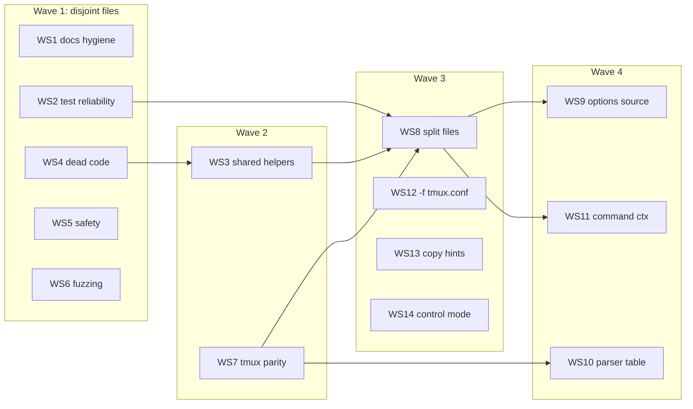

# Plan: codebase health workstreams

**Spec:** docs/specs/2026-11-15-codebase-health.md
**Goal:** land WS1 to WS14 as one PR each, merged to main, main green after every merge.
**Orchestrator:** AI. The coordinator writes briefs, reviews and merges; it never edits code.

## Shape

An arrow means the later workstream edits the same files heavily and must start from a main that
already has the earlier one. Everything inside a wave runs in parallel. A wave starts per
workstream as soon as its own arrows are merged, not when the whole previous wave is done.

| WS | Branch | Owns (main files) | Agent | Review |
|---|---|---|---|---|
| 1 | docs/health-hygiene | docs/**, README.md, tests/docs_*.rs | implementer | coordinator |
| 2 | test/wait-until | tests/**, the two flaky tests' modules | implementer | coordinator |
| 4 | chore/dead-code | src/compat/tmux/**, stale comments anywhere | implementer | package-reviewer |
| 5 | fix/safety-actor | graphics.rs, snapshot.rs, restore.rs, adopt.rs, layout.rs (one line) | implementer | package-reviewer |
| 6 | test/fuzz | fuzz/**, .github/workflows/fuzz.yml | implementer | coordinator |
| 3 | refactor/shared-helpers | callers listed in WS3 | implementer | package-reviewer |
| 7 | feat/tmux-parity | cmd/keys.rs, cmd/target.rs, format providers, NO_EFFECT | implementer | package-reviewer |
| 8 | refactor/split-files | dispatch/options.rs, clients.rs, input.rs, layout.rs | implementer | package-reviewer |
| 12 | feat/tmux-conf-f | main.rs, config/load, compat front end | implementer | package-reviewer |
| 13 | feat/copy-hints | server/copy/hints.rs (new), copy/mod.rs | implementer | package-reviewer |
| 14 | feat/control-mode | server/control/** (new), protocol, client | implementer, opus fixer on demand | package-reviewer |
| 9 | refactor/options-source | options table, config/mod.rs, compat names | implementer | package-reviewer |
| 10 | refactor/parser-table | cmd/parse.rs, cmd/table.rs (new), main.rs aliases | implementer | package-reviewer |
| 11 | refactor/command-ctx | server/mod.rs, dispatch/** | implementer | package-reviewer |

## Per workstream loop

1. `wt switch --create <branch> --base origin/main --no-cd -y` gives the worktree.
2. One `superlite:implementer` agent gets the brief: the spec section verbatim by path, the rules
   section, the worktree path, the isolated test script, and "open no PR, push nothing, reply with
   status, commits and test result". It works test first and commits on its branch.
3. The coordinator merges the latest `origin/main` into the branch, runs the isolated suite, pushes
   and opens the PR.
4. Code workstreams get a fresh `superlite:package-reviewer` on the PR diff with the spec section;
   it fixes its own findings with regression tests on the branch.
5. CI green and review clean: `gh pr merge --merge`, then the isolated suite on the new main.
   Red: a fixer agent on the branch, back to step 3.

## Rulings

- Ruling: PR-sized workstreams, not the superlite 2 to 5 minute task graph - each finding is an
  independent change with its own acceptance test, and one branch per finding keeps every PR
  reviewable - cost if wrong: an implementer runs long on WS8, WS10 or WS14; those may be split
  into stacked PRs by their implementer.
- Ruling: at most 5 implementers at once - each full suite starts hundreds of servers, and more
  parallel suites on one machine cause the timing flakes WS2 fixes - cost: a slower wall clock.
- Ruling: merge after green CI and a clean review without asking again - the owner asked for these
  to be addressed by subagents and has asked for merge-then-verify on the previous PRs - cost: a
  change the owner would have vetoed lands on main; every merge is a merge commit and reverts
  cleanly.
- Ruling: WS1's README edits about Luau wait for #11 - the statements are only wrong once it lands.
- Ruling: another session works on main in parallel (agents); every branch merges `origin/main`
  before its PR and again before merge.
