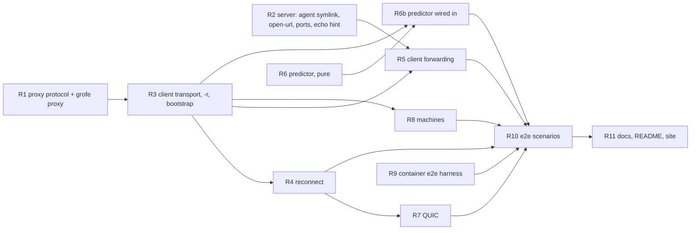

# Plan: remote sessions over ssh

**Spec:** docs/specs/2026-11-15-ssh-remote.md
**Branch:** feat/ssh-remote (one PR). Each task below is built on its own branch
`feat/ssh-remote--<task>` off the current feat/ssh-remote, in its own `wt` worktree, and merged
back by the coordinator. The coordinator writes briefs, merges and reviews; it never edits code.

| Task | Owns | Done when |
|---|---|---|
| R1 | src/remote/{mod,proxy_proto,proxy}.rs, `proxy` subcommand in main.rs, docs/protocol-proxy.md, tests/fixtures/proxy/ | framing, flow control and hello pinned by fixtures; `grofe proxy` over a socketpair attaches to a real server, opens control, tcp and upload channels |
| R2 | server: session env (stable agent symlink), `open-url` verb + event + `grofe open`, procinfo ports + `#{pane_ports}` + `list-ports` + `ports-changed`, `pane-echo` hint, new options | each with tests through the control socket |
| R3 | src/remote/{connect,bootstrap,ssh}.rs, client.rs transport generalisation, `-r`/`ssh://` parsing | client attaches through `grofe proxy` over pipes; bootstrap asks, verifies SHA256SUMS, installs from a local release dir; non-attach commands run remotely |
| R4 | src/remote/reconnect.rs, client overlay bar | drop by EOF and by missed pings both reconnect with the backoff schedule; stale frame kept, full redraw after; detach key works while offline |
| R5 | src/remote/forward.rs (open-url, uploads, port forwards, prompts) | each forwarding path tested over pipes |
| R6 | src/remote/predict.rs | predictor unit tests from recorded frame sequences (confirm, mismatch, alt screen, timeout, password) |
| R6b | wiring predict into the client, `#{client_rtt}` | predictions drawn and cleared on a delayed pipe |
| R7 | src/remote/quic.rs, Cargo.toml (quinn, rustls, rcgen) | bootstrap line, pinned cert, token, migration test on loopback; Opus security review |
| R8 | src/remote/machines.rs, picker overlay, `machine` CLI, `agent list --all-machines` | two fake machines over pipes: switch, combined list, offline dimming |
| R9 | containers/ssh/**, scripts/ssh-e2e.sh, CI job | sshd container reachable, grofe built inside, one smoke scenario |
| R10 | tests/ssh_e2e/** scenarios | install, drop/reconnect, netem latency + echo, port forward, upload, QUIC address change |
| R11 | docs/remote.md, config-reference, README, roadmap, site/book if #17 merged | docs tests green |

## Waves

1. R1, R2, R6, R9 in parallel (disjoint files; R2 is server-only, R6 pure).
2. R3 after R1.
3. R4, R5, R6b, R8 after R3 (R5 also after R2); R7 after R4.
4. R10 after all, R11 last; then the whole-branch review, merge main, PR, CI, merge, verify main.

## Reviews

- Each task: a `superlite:package-reviewer` on its diff before it merges into feat/ssh-remote.
- R7 and the bootstrap/install path of R3: also a `superlite:fixer-opus` security pass.
- Final: a fresh reviewer on the whole branch diff with the spec.

## Rulings

- Ruling: sub-branches merged into one feature branch - one PR as asked, but parallel agents
  need disjoint worktrees - cost: coordinator merges; conflicts are small because files are
  disjoint.
- Ruling: #39 and #40 land first (another session merges them); feat/ssh-remote merges main
  before the PR - cost: likely conflicts in main.rs and client.rs, resolved by a fixer.
