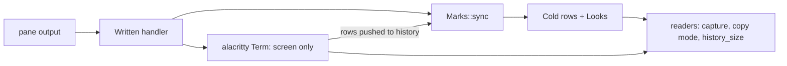
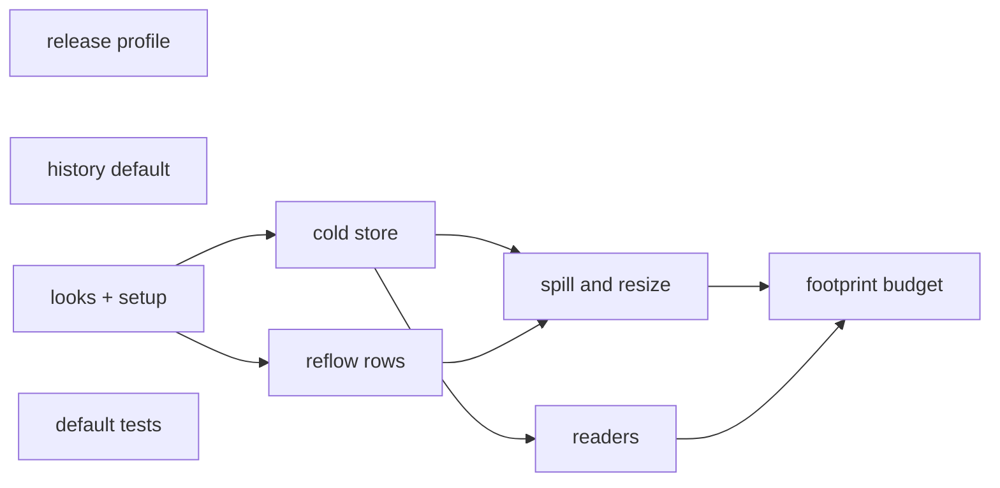

# Plan: a tmux-sized memory footprint

**Goal:** grofe's server memory close to tmux's: compact scrollback, tmux's history default, a lean release build, and a footprint budget that CI enforces.
**Architecture:** alacritty keeps only the visible screen. Rows it pushes into history move, after every operation, into `Cold`: a grofe-owned compact store (one string plus style runs per row, styles interned per pane). Every history reader reads `Cold` first, then the screen.
**Tech stack:** Rust 2024, alacritty_terminal 0.26, `cargo test`, `bats tests/cli.bats`.
**Spec:** this file, section "Design".
**Detail:** tests
**Target-min:** 14

## Design

Measured 2026-11-19 (macOS arm64, 200x50 panes, 46 MB coloured output, tmux 3.8):

| | grofe | tmux |
|---|---|---|
| physical footprint, 21 idle panes (80x24) | 8.0 MB | 3.0 MB |
| server after the output, default history | 277 MB | 8 MB RSS |
| same at history-limit 2000 | 28 MB | 8 MB RSS |
| release binary | 18.9 MB | 1.1 MB |

Causes: alacritty's 24-byte `Cell` at full row width (4.8 KB per 200-column line); a 50,000-line default (tmux 2,000) plus 4,096 slack rows; no release profile.

What changes:
1. **D1 Cold store.** `Cold` holds history rows compactly: per row the cells up to its used width as UTF-8 text plus `(len, look)` runs, its `wrapped` flag and used width. A look is fg, bg, flags (WRITTEN kept), underline colour, zero-width chars and hyperlink, interned per pane in `Looks`. Target: at most 400 bytes per 115-character single-style row.
2. **D2 Spill.** `Marks` owns the pane's `Cold`. `Marks::sync` moves every row alacritty holds in its history into `Cold`, oldest first, then empties alacritty's history. `Cold` enforces `history-limit`; the rows it drops are trimmed from the marks as now. Total history is `cold.len() + term.grid().history_size()` everywhere grofe says history today.
3. **D3 Resize.** Height growth pulls the newest `Cold` rows back onto the screen top, as tmux and alacritty do from history: scroll the screen down `k` rows, write the rows into lines `0..k`, move the cursor down `k`. Width changes reflow `Cold` the way tmux's `grid_reflow` does (join wrapped rows, re-split at the new width, a wide character never split), and the marks follow through `Marks::reflow` with `cold.shapes()` before and after.
4. **D4 Readers.** `history_size`, `copy_grid`, `capture*`, `copy_images`, `clear_history`, `#{history_bytes}` and `io.rs` read `Cold` then the screen. Output is byte-identical to today.
5. **D5 Defaults.** `history-limit` defaults to 2000, as tmux.
6. **D6 Release profile.** `lto = "thin"`, `codegen-units = 1`, `strip = "symbols"`.
7. **D7 Budget.** `scripts/footprint.sh` measures the table above; `tests/footprint.rs` (ignored by default, run in CI) fails over budget: 21 idle 80x24 panes at most 10 MB; after 46 MB at the default limit at most 20 MB; at history-limit 50000 at most 60 MB. Footprint is macOS `phys_footprint` (`vmmap --summary`) or Linux `RssAnon`.

Rulings:
- Ruling: history-limit default 2000 (because tmux parity and the user picked it; cost if wrong: users wanting more set it, and Cold makes that cheap).
- Ruling: Cold lives inside Marks (because Marks already keys every history row by absolute index and drops rows in sync; cost if wrong: one rename later).
- Ruling: looks are never evicted (ponytail ceiling: a truecolor flood grows the table by about 64 bytes per distinct look; clear-history resets it).
- Ruling (revised in review): before a resize the newest stored lines go back to alacritty and reflow with the screen, so a line wrapping from Cold onto the screen is rejoined as tmux does. Only alternate-screen resizes keep the old split (ponytail ceiling).
- Ruling: detail `tests`, T3 and T7 `full` (the 15k cap).
- Ruling: throughput is checked locally, not asserted in CI (timing is noisy on shared runners); at most 10% slower than before on the 46 MB run.
- Ruling: the code-size work (dedupe, no behaviour change) is a second plan after this merges, starting from a duplication survey.

## Main diagram

## File structure

- `src/server/pane/looks.rs`: `Looks`, interning a cell's style to a `u32`.
- `src/server/pane/cold.rs`: `Cold`, the compact history rows, limit, shapes.
- `src/server/pane/reflow.rs`: `reflow_rows`, tmux's `grid_reflow` over decoded rows.
- `src/server/pane/marks.rs`: owns `Cold`; spill, pull-back, reflow with Cold.
- `src/server/pane/written.rs`: history counts become totals.
- `src/server/pane/mod.rs`, `src/server/pane/io.rs`, `src/server/dispatch/options/formats.rs`: readers.
- `src/server/dispatch/options/table.rs`, docs: the default.
- `Cargo.toml`: release profile.
- `scripts/footprint.sh`, `tests/footprint.rs`, `.github/workflows/ci.yml`: the budget.

## Task graph

```mermaid
%% schedule
gantt
  title Predicted schedule (mm:ss)
  dateFormat X
  axisFormat %M:%S
  section lane 1
  T8 looks and module setup :t8, 0, 228s
  T3 cold store :t3, 228, 330s
  T4 spill and resize in marks :t4, 558, 330s
  T6 footprint budget and docs :t6, 888, 413s
  section lane 2
  T2 history-limit default 2000 :t2, 0, 138s
  T7 reflow rows :t7, 228, 296s
  T5 readers through cold :t5, 558, 285s
  section lane 3
  T1 release profile :t1, 0, 107s
```

critical path: T8 → T3 → T4 → T6 (21.7 min) · peak width 3 · predicted build 21.7 min · predicted total ≈ 25.2 min (target ✗ 14.0)

## Build and defaults

### T1 release profile · Complexity 1 (O-1) · Est. context 22k
**Owns:** Cargo.toml
**Components:** 1
**LOC owned:** 6
**Tests:** fast
**Kind:** mechanical
**Model:** haiku
**Est. time:** 1.5 min
**Consumes:** none
**Produces:** none
**Review Focus:** none
**Test code (verbatim):** `cargo build --release` succeeds; `cargo test --lib` passes.
**Steps:** add `[profile.release]` with `lto = "thin"`, `codegen-units = 1`, `strip = "symbols"`; build; report the binary size before and after.

### T2 history-limit default 2000 · Complexity 2 (O-1) · Est. context 30k
**Owns:** src/server/dispatch/options/table.rs, docs/book/src/reference/options.md, tests/fixtures/config/show-config-explain.txt, docs/book/src/copy-mode.md
**Components:** 1
**LOC owned:** 30
**Tests:** fast
**Model:** sonnet
**Est. time:** 2 min
**Consumes:** none
**Produces:** none
**Review Focus:** `show_g_history_limit_is_2000`: `show -gv history-limit` on a fresh server prints `2000`.
**Test code (verbatim):** named test above in the options table's test module; every test that asserted `50000` updated.
**Steps:** change the default; regenerate the options reference (`just docs`); fix the tests and fixtures that name 50000; say in the copy-mode page that the default matches tmux.

### T9 tests pinning the old default · Complexity 2 (O-1) · Est. context 30k
**Owns:** src/server/dispatch/options/tests.rs, tests/config.rs, tests/options_lists.rs, tests/options.rs, tests/fixtures/compat/golden/b2a/options.golden, tests/fixtures/compat/golden/fe_2/lists.golden, tests/compat/tp_4.rs, tests/compat/fe_3.rs, tests/compat/normalize.rs, docs/book/src/configuration.md
**Components:** 1
**LOC owned:** 40
**Tests:** fast
**Model:** sonnet
**Est. time:** 2 min
**Consumes:** none
**Produces:** none
**Review Focus:** none
**Test code (verbatim):** existing tests that pin grofe's own 50000 now pin 2000; recorded tmux behaviour unchanged.
**Steps:** follow-up to T2 (coordinator ruling), done by T2's agent.

## History store

**Probe entry:** call=grofe::server::pane::cold::Cold::push

### T8 looks and module setup · Complexity 3 (O-1) · Est. context 28k
**Owns:** src/server/pane/looks.rs, src/server/pane/reflow.rs (stub), src/server/pane/mod.rs (the three `mod` lines only)
**Components:** 1
**LOC owned:** 110
**Tests:** fast
**Model:** sonnet
**Est. time:** 2.5 min
**Consumes:** none
**Produces:** Looks::new() -> Looks · Looks::intern(&mut self, cell: &SnapCell) -> u32 · Looks::get(&self, id: u32) -> &SnapCell · Looks::len(&self) -> usize · reflow::ColdMeta { wrapped: bool, used: usize }
e.g. `Looks::new().intern(&blank)` -> 0 for the default blank; the same look again -> the same id
e.g. two cells differing only in `c` -> the same id; differing in fg -> a new id, `len()` 2
**Review Focus:** `zerowidth_and_hyperlink_in_key`: a look with a combining char or an OSC 8 link interns apart from one without, and `get` returns it equal.
**Test code (verbatim):** the two `e.g.` lines and the Review Focus test in looks.rs's test module.
**Steps:** add `pub(crate) mod cold; pub(crate) mod looks; pub(crate) mod reflow;` to pane/mod.rs, an empty-bodied `cold.rs` (`//! Compact history rows.`), and reflow.rs holding `ColdMeta` (Debug, Clone, Copy, PartialEq, Eq, Default) and `reflow_rows` returning its input unchanged; then looks, test first. `SnapCell` is the existing type in pane/mod.rs; a look is a `SnapCell` with `c` set to ' '.

### T3 cold store · Complexity 5 (O-2) · Est. context 36k
**Owns:** src/server/pane/cold.rs
**Components:** 1
**LOC owned:** 200
**Tests:** fast
**Model:** sonnet
**Detail:** full
**Est. time:** 4 min
**Consumes:** Looks::new, Looks::intern, Looks::get, reflow::ColdMeta (T8)
**Produces:** Cold::new(limit: usize) -> Cold · Cold::push(&mut self, cells: &[SnapCell], used: usize, wrapped: bool) -> usize · Cold::len(&self) -> usize · Cold::row(&self, i: usize, cols: usize, out: &mut Vec<SnapCell>) -> ColdMeta · Cold::pop_newest(&mut self, cols: usize, out: &mut Vec<SnapCell>) -> Option<ColdMeta> · Cold::set_limit(&mut self, limit: usize) -> usize · Cold::clear(&mut self) · Cold::shapes(&self) -> Vec<RowShape> · Cold::reflow(&mut self, cols: usize) · Cold::bytes(&self) -> usize
e.g. `Cold::new(2).push(&row("ab"), 2, false)` -> 0 dropped; a third push into a limit of 2 -> 1 dropped and `len()` 2
e.g. `row(0, 4, out)` on a pushed "ab" -> out is `a b ' ' ' '`, meta `{wrapped: false, used: 2}`
e.g. pushes "abcd"(wrapped, used 4), "ef"(used 2): `shapes()` -> `[RowShape{len: 4, wrapped: true}, RowShape{len: 2, wrapped: false}]`
**Review Focus:** `written_blank_kept`: used 5 with trailing written blanks returns them with WRITTEN; `bytes_per_row_budget`: 1000 pushes of a 115-char single-style row, 8 colours cycling, give `bytes() / 1000 <= 400`; `limit_zero_keeps_nothing`; `pop_newest_returns_last_pushed`.
**Test code (verbatim):** the four Review Focus tests and the three `e.g.` lines, in cold.rs's test module.
**Steps:** failing tests, FAIL, implement, PASS.
**Notes:** `push` returns the oldest rows the limit dropped. `row` pads with default blanks (fg/bg `Named(Foreground/Background)`, no flags). Row text is one `Box<str>`, runs `Box<[(u16, u32)]>`; default blanks past `used` are not stored. `reflow` decodes all rows, calls `reflow::reflow_rows(&rows, cols)`, stores the result (tested in T4). `RowShape` is marks.rs's existing type.

### T7 reflow rows · Complexity 5 (O-2) · Est. context 30k
**Owns:** src/server/pane/reflow.rs (replacing T8's stub)
**Components:** 1
**LOC owned:** 170
**Tests:** fast
**Model:** sonnet
**Detail:** full
**Est. time:** 3 min
**Consumes:** reflow::ColdMeta (T8)
**Produces:** reflow::reflow_rows(rows: &[(Vec<SnapCell>, ColdMeta)], cols: usize) -> Vec<(Vec<SnapCell>, ColdMeta)>
e.g. rows "abcd"(wrapped, used 4), "ef"(used 2), cols 3 -> "abc"(wrapped, used 3), "def"(used 3)
e.g. rows "ab"(used 2), "cd"(used 2), cols 1 -> "a"(w), "b", "c"(w), "d"
e.g. rows "abc"(wrapped, used 3), "d"(used 1), cols 8 -> "abcd"(used 4)
**Review Focus:** `wide_char_never_split`: "ab界" (界 is WIDE_CHAR then WIDE_CHAR_SPACER) at cols 3 -> "ab"(wrapped) and "界"; `written_blanks_survive_join`; `empty_row_stays_one_row`; `cols_zero_returns_input`.
**Test code (verbatim):** the three `e.g.` lines and four Review Focus tests in the file's test module; build rows with a local `fn row(s: &str, used: usize, wrapped: bool)` helper.
**Steps:** failing tests, FAIL, implement, PASS.
**Notes:** tmux 3.7b `grid_reflow`: consecutive rows joined while `wrapped`, the logical line's used width is the last row's `used` plus the full widths before it; re-split at `cols`, every row but the last `wrapped` and `used == cols` (less one when a wide char moved down).

## Wiring

### T4 spill and resize in marks · Complexity 6 (O-2) · Est. context 55k
**Owns:** src/server/pane/marks.rs, src/server/pane/written.rs
**Components:** 1
**LOC owned:** 200
**Tests:** fast
**Model:** sonnet
**Est. time:** 4 min
**Consumes:** Cold::new, Cold::push, Cold::pop_newest, Cold::set_limit, Cold::shapes, Cold::reflow, Cold::len (T3) · reflow::reflow_rows (T7, through Cold::reflow)
**Produces:** Marks::cold(&self) -> &Cold · Marks::cold_mut(&mut self) -> &mut Cold · Marks::history_len<L: EventListener>(&self, term: &Term<L>) -> usize
e.g. after 10 lines into a 3-row screen with limit 100: `history_len` 7, `cold().len()` 7, `term.grid().history_size()` 0
e.g. limit 5 and 10 lines into a 3-row screen: `history_len` 5 and the marks of the dropped rows are gone
**Review Focus:** `spill_keeps_alacritty_history_empty`; `grow_pulls_rows_back`: 10 lines in a 3-row pane, resize to 6 rows: the screen shows lines 5..10 and `history_len` 4, as before this change; `shrink_then_grow_roundtrip`; `width_change_moves_marks_with_cold_rows`: a prompt mark on a cold row lands where `Marks::reflow` puts it; `alt_screen_spills_nothing`; `scroll_up_10_with_slack`: `CSI 10 S` on a full screen spills 10 rows in one sync.
**Test code (verbatim):** the named tests, using the module's existing `Rig` harness.
**Steps:** failing tests, FAIL, implement, PASS. Every `grid.history_size()` in these files that means total history becomes `history_len`.
**Notes:** spill reads `grid[Line(-h)]..grid[Line(-1)]` into `SnapCell`s with WRITTEN kept, `used` from the row's last WRITTEN cell, `wrapped` from `WRAPLINE` on the last cell; then `update_history(0)` and `update_history(HISTORY_SLACK)`. The image store's `scroll_op` gets the total.

### T5 readers through cold · Complexity 5 (O-2) · Est. context 60k
**Owns:** src/server/pane/mod.rs, src/server/pane/io.rs, src/server/dispatch/options/formats.rs
**Components:** 1
**LOC owned:** 160
**Tests:** fast
**Model:** sonnet
**Est. time:** 4 min
**Consumes:** Marks::cold, Marks::cold_mut, Marks::history_len (T4) · Cold::row, Cold::len, Cold::clear, Cold::bytes (T3)
**Produces:** none
**Review Focus:** `capture_s_minus_identical`: `capture-pane -p -S - -e -J` over 300 coloured lines with tabs and wide chars is byte-identical to the output before this change (fixture recorded first); `copy_grid_rows_in_order`: oldest cold row first, then the screen; `clear_history_empties_cold`; `history_bytes_counts_cold`.
**Test code (verbatim):** the named tests in `pane/mod.rs`'s test module; record the fixture from main before changing code.
**Steps:** record fixture, failing tests, FAIL, implement, PASS.
**Notes:** readers iterate `0..cold.len()` through `Cold::row` then alacritty's rows, building the same `SnapCell` rows as `snap_row_into`; strip WRITTEN where `snap_row_into` strips it.

## Budget

### T6 footprint budget and docs · Complexity 3 (O-1) · Est. context 35k
**Owns:** scripts/footprint.sh, tests/footprint.rs, .github/workflows/ci.yml, docs/book/src/performance.md, docs/book/src/SUMMARY.md
**Components:** 2
**LOC owned:** 150
**Tests:** slow
**Model:** sonnet
**Est. time:** 3 min
**Consumes:** grofe binary (all tasks)
**Produces:** none
**Review Focus:** `idle_21_panes_under_10mb`, `after_46mb_default_under_20mb`, `after_46mb_limit_50000_under_60mb` (D7 numbers); the script never touches the default socket and wipes its state dir between runs.
**Test code (verbatim):** the three named tests, `#[ignore]`, run by a CI step `cargo test --release --test footprint -- --ignored`.
**Steps:** script, tests, CI step, a book page with the measured table before and after.

## Review Focus

Package `pane` (library, state): deep (reflow joins and splits), encoding (wide chars, zero-width, hyperlinks), state (limit drops versus marks, alt screen), numeric (byte budget). Specific risks: a reader that still uses alacritty's `history_size` and so loses Cold rows; marks off by the rows spilled; pull-back that moves the cursor wrongly.

## Self-review

Coverage: D1 T8 T3, D2 T4, D3 T4 T7, D4 T5, D5 T2, D6 T1, D7 T6.
