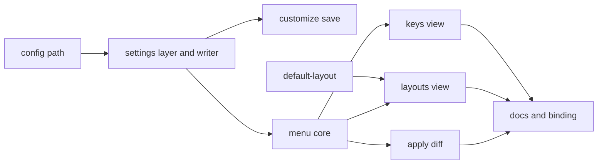

# Settings menu: plan

**Spec:** docs/specs/2026-11-20-settings-menu.md
**Goal:** config path, write-back to settings.toml, and a native fuzzy settings menu, in three PRs.
**Stack:** Rust 2024; tests via `cargo test` with GROFE/TMUX unset and a private TMPDIR; e2e tests use the `tests/common` harness on a private `-S` socket.
**Bloat rule:** each task reuses `listview`, `keymenu`/`listdraw`, `customize` data and `prompt::ask`; anything it needs from them is made shared, not copied. Each PR reports its net line change.

## PR 1

### T1 config path
- **Owns:** src/main.rs (flag parsing), src/config/mod.rs (`Env`), src/server/dispatch/options/reload.rs, src/config/cli.rs, new tests/config_path.rs, docs/book/src configuration page.
- **Produces:** `config::Env::from_process_with(config: Option<PathBuf>) -> Env` with `config_file` and `config_dir`; the server keeps the resolved path for `reload`.
- **Tests:** T1-T9, T33, T35 (path half).

## PR 2

### T2 settings layer and writer
- **Owns:** src/config/load.rs, src/config/provenance.rs (`Layer::Settings`), new src/config/write.rs, Cargo.toml (`toml_edit`).
- **Produces:** `config::write::set(dir: &Path, key: &str, value: toml_edit::Item) -> Result<Saved, String>`, `unset(dir, key)`, `set_binding(dir, table, key, cmd)`; each writes atomically and returns the old bytes for rollback.
- **Tests:** T10-T15, T32, T34.

### T3 customize save
- **Owns:** src/server/customize/mod.rs, src/server/tree/keys.rs (the `S` key).
- **Consumes:** T2's writer; makes `customize::value_of` and the option-to-TOML-key mapping shared for T5.
- **Tests:** T16-T18.

## PR 3

### T4 default-layout option
- **Owns:** options table row, new-session path, src/layouts/mod.rs (a callable `build(name, session)` shared with `layout up`).
- **Tests:** T29.

### T5 menu core
- **Owns:** new src/server/settings/ (state, rows, sections, overlay, hook), registration in src/server/mod.rs, `settings` command in src/cmd.
- **Consumes:** `listview` scoring and list state, `listdraw::draw_list`, customize data, `prompt::ask`, T2's writer.
- **Produces:** a snapshot taken at open, live set-option on change, restore on cancel.
- **Tests:** T19-T25, T31, T35 (query half), T36.

### T6 keys view
- **Owns:** src/server/settings/keys.rs.
- **Tests:** T27.

### T7 layouts view
- **Owns:** src/server/settings/layouts.rs (preview drawing).
- **Tests:** T28.

### T8 apply diff
- **Owns:** src/server/settings/apply.rs.
- **Tests:** T26.

### T9 docs and binding
- **Owns:** src/server/input/defaults.rs (`prefix C` in grofe identity), docs/book/src/settings.md, SUMMARY.md, options reference (`just docs`), site/index.html feature line.
- **Tests:** T30, T19 (binding half).
- **Follow-up:** canopy PR moving its plain new-window from `C` to `M-c`.
