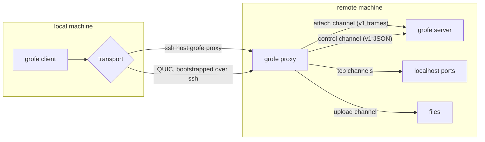

# Spec: remote sessions over ssh that feel local

**Status:** approved by the owner 2026-11-15 ("do all phases 1 to 4 in a single PR").
**Goal:** a grofe session on another machine feels like a local one: it opens with one command,
survives dropped connections and sleep without losing anything, forwards what a developer needs
(clipboard, URLs, files, ports, ssh-agent), hides latency, and sits next to local sessions in one
window with one agent list.

Prior art read: cmux (`cmux ssh`: versioned remote helper over ssh stdio, reconnect with backoff,
injected keepalives, scp upload on drop, mosh transport) and herdr (`herdr --remote`, saved
machines, combined agent list, only the selected machine streams its screen, dimmed cached screen
while offline, backoff to 2 min). grofe's advantage: the server owns every pane's grid and the
client is a thin tty pipe (protocol v1 §7), so a reconnect is one full redraw and nothing is lost.

Out of scope (owner agreed): a built-in browser, copying local config or plugins to the remote.

## 1. Architecture

- **`grofe proxy`** (new subcommand, runs on the remote): speaks the proxy protocol on stdin/stdout
  (or on QUIC streams), and opens channels to the local server socket (starting the server like
  any CLI call does), to `127.0.0.1:<port>` for forwards, and to files for uploads. It holds no
  session state: losing it loses nothing.
- **Protocol v1 does not change** its frames (§8 forbids new frame kinds). Everything the server
  must say to a remote client goes through additive v1 verbs and events on the control channel.
- **Proxy protocol** (`grofe-proxy 1`, new, documented in protocol-proxy.md under docs, fixtures
  checked byte for byte like v1): after a one-line JSON hello each way (version, grofe version,
  os, arch, features), frames `[u8 kind][u32 channel][u32 len][payload]`, len at most 1 MiB.
  Kinds: `open` (channel, JSON: `{"type":"attach"|"control"|"tcp"|"upload", ...}`), `data`,
  `eof`, `close` (with reason), `ping`/`pong` (u64 nonce), `window` (u32 credit, per channel flow
  control so one busy channel cannot starve the attach stream). Unknown kind: close with an error
  line. Channel ids are chosen by the opener; local opens odd, remote even.

## 2. Phase 1: remote attach that survives drops

**CLI.** `grofe -r <host> [command...]` and `grofe attach ssh://[user@]host[:port][/session]`.
`<host>` is anything `ssh` accepts (aliases from `~/.ssh/config` work). Without a command,
`-r host` means `new-session -A -s main` there. Every non-attach command (`grofe -r host ls`,
`agent list`, ...) runs through a control channel and prints like the local CLI.

**Connect.** Run `ssh -T -o ServerAliveInterval=15 -o ServerAliveCountMax=2 <host> --
<remote-grofe> proxy`, the two `-o`s only when `ssh -G <host>` shows the user set no value.
ssh handles auth, ProxyJump, ControlMaster. `<remote-grofe>` is `grofe` on the remote `PATH`,
else `~/.local/share/grofe/bin/<version>/grofe`.

**Bootstrap.** If the remote has no grofe or its proxy version is incompatible, ask
`grofe is not installed on <host> (linux x86_64). Install v<version> to
~/.local/share/grofe/bin/<version>/? [y/N]`. `--install` answers yes, `--no-install` no. Install
downloads the release archive for the remote's os/arch on the local machine (the release URL is
an option, `remote-release-url`, overridable for tests and mirrors), checks it against the
release's `SHA256SUMS`, and copies it over the same ssh connection (an `upload` channel needs a
proxy, so the install uses `ssh host 'mkdir -p ... && cat > ...'`). Never sudo, never touches
the remote's config. `--install-from <path>` installs a local file instead (air-gapped hosts).

**Drop and reconnect.** The client detects a drop by EOF, an ssh exit, or two missed pings
(ping every 5 s on the proxy protocol). Then:
- the last frame stays on screen; the bottom row shows a reverse-video bar
  `grofe: reconnecting to <host> (attempt N, next in Ns) · prefix d detach` drawn by the client;
- input is dropped, except the detach key, which ends the client cleanly;
- retries back off 0.5 s, 1, 2, 4 ... capped at 30 s, with ±20% jitter; a connection that stays
  up 60 s resets the backoff; a resumed wake from sleep (wall clock jump over 5 s) retries at once;
- on reconnect the client re-attaches to the same session by id (the attach reply's session),
  sends its size, and the server's full redraw replaces the stale frame.
`remote-reconnect off` makes a drop exit like today.

**Local nesting.** A remote session needs no nested prefix: the local terminal runs exactly one
grofe client.

## 3. Phase 2: forwarding

- **Clipboard:** OSC 52 already reaches the local terminal through the output stream; no change.
  Document it.
- **Notifications:** already escapes to the local terminal; for machines not on screen (phase 4)
  they arrive as `notify` events on the control channel.
- **Open URLs locally.** New verb `open-url <url>` and event `open-url {url, pane}`; `grofe open
  <url>` is the CLI. Panes get `BROWSER="grofe open"` when the session option
  `forward-browser` is on (default on). A remote client subscribed to `open-url` opens the URL
  with the local `open`/`xdg-open`; with no remote client attached, `grofe open` falls back to
  the remote's own opener. Only `http`, `https` and `file` (file: only if the path exists
  locally) are opened; others are refused with a message.
- **Files.** A bracketed paste whose content is one or more absolute paths that all exist locally,
  sent to a remote session, is uploaded through `upload` channels to the pane's cwd (else
  `~/.cache/grofe/uploads/`), and the remote paths are pasted instead, shell-quoted.
  `remote-upload-paste ask|on|off` (default `ask`: a one-line client prompt `upload 2 files
  (3.1 MB) to host:~/src? [y/N]`). Size cap `remote-upload-max` (default 100 MiB). Name clashes
  get ` (2)` suffixes, never overwrite.
- **ssh-agent.** Each session keeps `SSH_AUTH_SOCK` pointing at a stable symlink
  `<runtime-dir>/agent/<session-id>.sock`; every attach whose client env has `SSH_AUTH_SOCK`
  repoints it atomically (rename over). Old panes keep a working agent after a reconnect. Works
  for plain `ssh host` + `grofe attach` too. Option `stable-ssh-agent` (default on).
- **Ports.** procinfo learns the TCP ports a pane's processes listen on (Linux: `/proc/net/tcp*`
  joined with `/proc/<pid>/fd` socket inodes for the pane's process tree; macOS: `proc_pidfdinfo`
  socket info). New format `#{pane_ports}` (comma list), verb `list-ports [-a]`, event
  `ports-changed {pane, ports}` (polled at most every 2 s, only while a subscriber exists).
  A remote client applies `remote-forward-ports ask|auto|off` (default `ask`): a new port shows
  a one-line client prompt `forward host:5173 to localhost:5173? [y/N/always]`; the local
  listener binds `127.0.0.1:<same port>`, or the next free port if taken (shown in the prompt
  result). Forwards close when the port closes or the client exits. `grofe -r host ports` lists
  them.

## 4. Phase 3: latency

- **Predictive local echo** (mosh's idea). The client keeps a mirror grid of the attach output
  (`alacritty_terminal`, already a dependency). When `predictive-echo` is `auto` (default; only on
  remote connections with a smoothed RTT of 50 ms or more) or `on`: a printable key typed while
  the mirror is in the normal screen, the cursor is where the last prediction left it, and the
  last few predictions were confirmed, is drawn at once at the cursor, underlined. A server frame
  that shows the same cell confirms it (underline goes); a mismatch, an alt-screen switch, a
  cursor jump or 1 s without confirmation erases all pending predictions and repaints from the
  mirror. Backspace and left/right arrows predict too; Enter, control keys and escape sequences
  never do, and they flush pending predictions. Passwords: no prediction when the mirror's
  cursor line ends with a known password prompt (`assword:`, `passphrase`) or the pane has echo
  off (a new `pane-echo` hint the server sends in the control channel from the pty's termios).
- **RTT** is measured from ping/pong; `#{client_rtt}` shows it locally.
- **Roaming transport** `--transport quic` (or the option `remote-transport ssh|quic`): the
  client runs `ssh host grofe proxy --quic` once; the proxy binds a UDP port from
  `remote-udp-ports` (default `60001-61000`), makes a fresh self-signed certificate, prints one
  JSON line `{port, cert_sha256, token}` and detaches (its stdio closes, ssh exits); it serves
  exactly one client, which must present the 32-byte random token in its first stream, and it
  exits after `remote-quic-idle` (default 7 days) without a client. The client connects with
  `quinn`, accepting only that certificate (pinned by hash, no CA). QUIC connection migration
  carries a changed client address (Wi-Fi to tether, sleep and wake); a lost path reconnects with
  the same token. ssh stays available for bootstrap and install. If UDP is blocked the client
  says so and falls back to ssh.

## 5. Phase 4: many machines in one window

- **Saved machines:** `grofe machine add <name> <ssh-target> [--session s] [--transport t]`,
  `machine ls`, `machine rm`. Stored in `<config-dir>/machines.toml` (name, target, session,
  transport, enabled); never secrets.
- **One client, many connections.** `grofe` with machines saved (or `grofe --machines`) connects
  to the local server and every enabled machine. Only the selected one has an attach channel;
  the others keep a control channel subscribed to agent and notify events, so a slow machine
  never stalls the selected one.
- **Switching:** a client key (`machine-key`, default `M-m`, intercepted by the client before
  the server) opens a client-drawn picker: one row per machine (state: connected, reconnecting,
  offline), its sessions, and its agents with their state (working, blocked, done, idle). Enter
  attaches there; the previous attach channel closes (the session keeps running). `M-[1-9]`
  in the picker jump directly. A machine with a blocked agent or an unread notification shows a
  marker in the client's bottom bar segment `#{client_machines}` too.
- **Combined agent list:** `grofe agent list --all-machines` prints every machine's agents with a
  `machine` column; `grofe --machine <name> agent ...` targets one.
- **Offline machines** show their last known agent states dimmed, marked offline.

## 6. Testing

- Unit tests: proxy protocol framing and flow control (fixtures), backoff schedule, URL
  allow-list, paste path detection and quoting, upload naming, port parsing from `/proc/net/tcp`
  samples, the predictor against recorded frame sequences, machines.toml round trip.
- Integration tests (no ssh): the client and `grofe proxy` joined by a socketpair or pipes,
  driving a real server: attach, kill the pipe, reconnect, full redraw, no lost pane output.
- Container end-to-end (`containers/ssh/`): an sshd container with a linux grofe build; scripts
  connect with `-r`, install via bootstrap from a local release dir, drop the link (kill sshd
  child, `tc netem loss 100%` then restore), add 200 ms latency for predictive echo, forward a
  port from a container web server, upload a file, run QUIC with a changed client address.
  `scripts/ssh-e2e.sh` runs them; a CI job runs them on ubuntu.
- Never the default tmux or grofe server; private sockets everywhere.

## 7. Docs

a new user guide, remote.md under docs (connecting, install, reconnect, forwarding, latency, machines,
security notes), protocol-proxy.md, the new options in `docs/config-reference.md`,
README (a "Remote sessions" section and the feature list), roadmap (remove the ssh items),
and the landing page and the mdBook guide (both from PR #17, now on main).

## 8. Security

- No listening TCP port on the remote except the opt-in QUIC one, which accepts one pinned
  client with a random token. Port forwards bind `127.0.0.1` locally only.
- `open-url` allow-list; uploads never overwrite; install verifies SHA256SUMS; no sudo.
- The QUIC transport, token handling and certificate pinning get an Opus security review.

## Rulings

- Ruling: one PR for all four phases - the owner asked for it - cost: a large review; mitigated
  by one commit series per task and a dedicated review per area.
- Ruling: a proxy protocol under v1 instead of protocol v2 - v1 §8 forbids new frame kinds, and
  everything the server must add is additive verbs and events - cost: two protocols to document.
- Ruling: QUIC via `quinn`/`rustls`/`rcgen` with a cert pinned over ssh instead of reusing mosh -
  mosh carries only a pty, so forwards, uploads and the agent list would need a second channel
  anyway - cost: new dependencies and a crypto surface, hence opt-in and an Opus review.
- Ruling: grofe installs itself on the remote after asking - matches herdr; release archives and
  SHA256SUMS exist since #19 - cost: a network download from the local machine.
- Ruling: machine switching is client side - one stalled machine must not block another, and
  servers stay unaware of each other - cost: the client grows a small overlay renderer.
- Ruling: predictive echo defaults to `auto` (remote, RTT 50 ms or more) - mosh's experience;
  `off` locally where it has no benefit - cost: a misprediction flashes for one frame.
